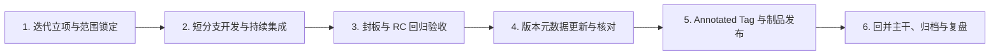

# 02 - 软件版本迭代与发布管理规范

> - 🟢 本文件适用于各类自研软件（桌面端、Web、服务端、CLI、SDK、移动端、Unity/XR 应用与资产包）的版本号规划、迭代发布、补丁维护与升级兼容管理。
> - 🔴 不适用：强行替换目标项目已稳定运行的发版流水线、应用商店审核制度或内部日期型（CalVer）版本规则（项目已有发布约定优先）。

---

## 1. 版本号体系与递增规则

🟡 **推荐默认体系**：采用 **语义化版本 2.0.0（Semantic Versioning，`MAJOR.MINOR.PATCH`）**；Git Tag 与对外发布展示常写作 `vMAJOR.MINOR.PATCH`（如 `v1.2.0`）。若团队项目按周期/日期发布（如 `2026.11.1`），沿用既有体系但仍须遵守本文的不可变性、封板与兼容治理红线。

### 1.1 主、次、修订号递增准则

| 位置 | 名称 | 何时递增 | 递增时的重置规则 | 典型场景 |
|---|---|---|---|---|
| `MAJOR` | 主版本号 | 发生**不向下兼容的破坏性变更** | `MINOR` 与 `PATCH` 归零（如 `1.4.2` → `2.0.0`） | 公开 API 协议断裂、配置文件/本地数据格式不兼容旧版、最低系统/运行环境抬升、核心架构重构导致既有用法失效 |
| `MINOR` | 次版本号 | 新增**向下兼容**的功能、模块或可选字段 | `PATCH` 归零（如 `1.4.2` → `1.5.0`） | 新增页面/业务流程、新增向后兼容接口、新增可选项、标记旧接口 `Deprecated` |
| `PATCH` | 修订号 | 仅做**向下兼容**的缺陷修复、安全补丁或微调 | 不重置前两位（如 `1.4.2` → `1.4.3`） | Bug 修复、崩溃修复、安全漏洞修补、性能微调、文案与样式修正 |

- 🟡 **`0.y.z`（孵化/内测期）与 `1.0.0`（正式稳定期）的边界**：
  - `0.y.z` 表示产品处于早期演进期，公开接口与结构仍可能调整，但团队内部仍应遵循“功能迭代升 `y`，缺陷修复升 `z`”。
  - 一旦软件进入正式客户交付、上线生产环境或对外承诺平滑升级与兼容保障，应正式切入 **`1.0.0`**，不再长期滞留在 `0.x.y` 规避兼容性管理。

### 1.2 预发布版本（Pre-release）演进阶梯

当一次大功能或重要版本需要分阶段测试与灰度验证时，按以下标准阶梯推进，**禁止随意拼接非标准后缀**：

| 阶段格式 | 阶段定位 | 面向范围 | 准入与推进条件 |
|---|---|---|---|
| `vX.Y.Z-alpha.N` | 内部开发联调版 | 研发、产品、美术内部 | 核心主链路可跑通，功能允许继续调整 |
| `vX.Y.Z-beta.N` | 公开测试/灰度版 | QA 测试团队、内部试用或种子用户 | **功能范围已冻结**，聚焦稳定性与体验修复 |
| `vX.Y.Z-rc.N` | 发布候选版（Release Candidate） | 验收团队、预发布环境 | 全量回归通过；无阻断级 Bug 即可直接转正为 `vX.Y.Z` |
| `vX.Y.Z` | 正式稳定版（GA） | 全体目标用户/生产环境 | 满足发版准出清单，正式归档与公告 |

```text
# ❌ 反例：命名混乱、无法排序比较、分不清哪个更新
v1.2-final
v1.2.0-final2
v1.2.0-fix-new
v1.2.0-test-0512

# ✅ 正例：严格遵循 SemVer 预发布阶梯，天然支持词法/工具比较排序
v1.2.0-alpha.1 → v1.2.0-alpha.2 → v1.2.0-beta.1 → v1.2.0-rc.1 → v1.2.0
```

### 1.3 双轨版本号：对外展示版本 vs 内部单调构建号

🔴 **客户端、移动端与 Unity/XR 必守规则**：面向应用商店（App Store、Google Play、PICO Store、Quest Store）、桌面端自动更新器或热更系统的软件，必须区分两条版本轨：

- **对外展示版本（Display Version / `versionName` / `CFBundleShortVersionString`）**：面向用户展示，按 SemVer 递增（如 `1.2.0`）。
- **内部构建号（Build Number / `versionCode` / `bundleVersionCode` / `CFBundleVersion`）**：供应用商店与更新器做数值大小比较，**每次对外出包必须严格单调递增**（例如正整数 `10200` → `10201` 或 CI 自增构建号）；即使同属 `1.2.0` 的重打包或提审被拒后的二次提审，也**严禁复用或回退旧构建号**。
- 🟡 **构建溯源三元组**：推荐在软件“关于”弹窗、启动日志或健康检查接口中同时输出 **`展示版本 + 构建号 + Git 短哈希`**（例如 `v1.2.0 (build 108 · a1b2c3d)`），确保任何线上工单与崩溃日志都能秒级定位到确切源码提交。

## 2. 版本迭代标准流程（从规划到发布）

一次完整的软件版本迭代应遵循以下六个阶段，各阶段配合 [01 - Git 版本控制规范](./01-Git版本控制规范.md) 的分支操作执行：



### 2.1 六阶段执行要求

1. **迭代立项与范围锁定（Planning / Milestone）**
   - 明确本次迭代的目标版本号（如 `v1.3.0`）、核心交付需求（Must-have）、明确不做的范围（Out of Scope）与验收准出标准。
   - 迭代中途新增需求必须经过评审并评估延期或置换既有需求，**禁止在无评估的情况下持续塞入新功能导致版本无限延期**。
2. **并行开发与持续集成（Development）**
   - 所有需求与缺陷修复按短分支开发并经 PR 评审合入主干；跨迭代的大特性未完成时，通过配置开关（Feature Flag）或隐藏入口隔离，保证主干随时处于可构建状态。
3. **封板与回归验收（Code Freeze & RC）**
   - 计划内需求全部合入后进入封板；若团队需同步启动下个迭代开发，从主干切出 `release/vX.Y.Z` 分支并打出 `vX.Y.Z-rc.1`。
   - 🔴 **封板红线**：封板后 `release/*` 分支（或封板中的主干）**只允许合入缺陷修复、构建修正与发版说明，严禁再合入未评审的新功能**。
4. **版本号统一更新与一致性核对（Version Bump）**
   - 在发版前统一更新项目内所有权威版本声明文件（如 `VERSION`、`package.json`、`ProjectSettings.asset`、`pom.xml`、`pyproject.toml`、安装脚本与发布文档）和 `CHANGELOG.md`。
   - 运行仓库既有版本一致性校验与全量测试，杜绝“Git Tag 写了 `v1.3.0`，安装包内置版本还是 `v1.2.0`”的错位。
5. **正式打标与制品发布（Tag & Release）**
   - 🔴 在验收通过的精确 Commit 上创建**附注标签（Annotated Tag）**并推送，优先由 CI 或可复现构建流程生成正式安装包/镜像/压缩包与 `SHA-256` 校验和文件：
     ```bash
     git tag -a v1.3.0 -m "Release v1.3.0"
     git push origin v1.3.0
     ```
   - 🟡 **推荐灰度放量**：面向较多终端用户或核心线上服务时，按 `内部验证 → 种子用户/测试集群 → 小流量灰度 → 全量发布` 推进，并观察崩溃率、错误日志与核心指标。
6. **回并、归档与复盘（Merge Back & Post-Release）**
   - 若使用了 `release/vX.Y.Z` 分支，发布后第一时间将封板期的修复提交与版本更新**回并至 `main` / `develop`**，再删除 `release/*` 分支。
   - 归档构建产物、校验清单与发布说明；收集上线反馈，将遗留优化项转入下个迭代池。

### 2.2 迭代流程正反例对比

| ❌ 反例 | ✅ 正例 |
|---|---|
| 边测试边往待发版分支继续合入新需求，导致测完 A 又把 B 改坏 | 明确封板节点，封板后仅合入 Bugfix；新需求进入下个迭代分支 |
| 手动在研发本机随手打包发给客户，既没有打 Git Tag 也没记 Commit | 基于干净的远端 Commit 打附注 Tag，通过标准化脚本/CI 产出带校验和的正式制品 |
| 发版前只改了 Git Tag，忘了更新桌面端 `package.json` / Unity `bundleVersion` | 统一更新所有版本源并执行一致性脚本，确保源码、制品与 Tag 三者一致 |

## 3. 发布制品、Tag 不可变性与 CHANGELOG 规范

### 3.1 已发布版本不可变性红线

- 🔴 **严禁删除重打已对外发布的 Tag 或静默覆盖线上制品**：一旦 `v1.2.0` 已经推送到公开/团队共享仓库、交付给客户、上传到包仓库或提交到应用商店，哪怕只漏了一个图标或需要修一行文案，**必须递增修订号发布 `v1.2.1`**，绝不允许覆盖替换原 `v1.2.0` 包体（否则会造成同名软件行为不同、SHA-256 校验失败与缓存污染）。
- 🔴 **制品必须可追溯与可校验**：每个正式 Release 至少保存对应的精确 Commit 哈希、安装包/资产列表、SHA-256 校验文件以及适用的操作系统/运行环境说明。

### 3.2 CHANGELOG 与 Release Notes 编写要求

- 🟡 推荐在仓库根目录或项目文档中持续维护 `CHANGELOG.md`（遵循 Keep a Changelog 倒序结构，顶部可保留 `## [Unreleased]` 汇总未发布改动），每次发版归档到对应版本标题与日期下：
  - `Added`（新增功能）
  - `Changed`（现有能力或行为变更）
  - `Fixed`（缺陷修复）
  - `Deprecated`（已标记废弃、计划未来移除的能力）
  - `Removed`（已移除的功能）
  - `Breaking Changes`（破坏性变更：**必须附具体升级与迁移步骤**）
- 🔴 **面向受众撰写 Release Notes**：正式发版说明要让用户、测试与运维看懂“改了什么、修了什么、升级需要注意什么”，**禁止不经整理直接把原始 `git log` 流水账原封不动粘贴为发版说明**。

## 4. 线上紧急修复（Hotfix）与回滚管理

### 4.1 线上紧急修复（Hotfix）标准流程

当线上正式版本（如 `v1.2.0`）爆发阻断级故障或高危安全漏洞，而当前 `main` / `develop` 已经合入了尚未验收的 `v1.3.0` 新功能时：

1. 🔴 **必须从线上正式发布 Tag 拉出热修分支**，严禁把未测完的 `v1.3.0` 改动一起打包带上线：
   ```bash
   git fetch origin --tags
   git switch -c hotfix/v1.2.1-token-crash v1.2.0
   ```
2. 仅做最小必要修复，并补充可复现原故障的回归测试。
3. 递增修订号至 `v1.2.1`（客户端同步递增内部构建号），更新 `CHANGELOG.md`，验收后打 `v1.2.1` Tag 并紧急发布。
4. 🔴 **立即回并主干**：发布完成后立刻将修复提交合并或 `cherry-pick` 回 `main`（以及正在封板的 `release/*` 分支），防止下个大版本上线后旧故障复发，随后删除热修分支。

### 4.2 回滚（Rollback）预案与设计前提

- 🔴 **无回滚预案不发正式生产版**：每次正式发布前明确“一旦发现阻断故障，如何 15 分钟内恢复服务或引导降级”：
  - 服务端/Web：保留上一稳定版本镜像与可逆的发布配置。
  - 客户端/桌面端：保留上一稳定版本安装包下载入口，并在自动更新服务支持暂停推送或下发回退版本。
- 🔴 **数据结构遵循先扩后缩（Expand-Contract）**：涉及数据库表结构、共享协议或本地配置删除/重命名字段时，新版本先兼容读取旧字段并同时写入新字段，确认不再需要回滚至旧版本后，再在后续版本清理旧字段，避免回滚后旧版软件因缺字段直接崩溃。

## 5. 数据、配置与接口的向后兼容治理

软件持续迭代的核心风险在于老用户升级失败或数据损坏，跨版本演进必须守住以下底线：

- 🔴 **持久化结构显式带 `schemaVersion`**：本地配置文件、用户偏好、本地数据库、项目锁文件、游戏/XR 存档与自定义导出文件均应携带显式版本号字段（如 `"schemaVersion": 2`）。
- 🔴 **升级必须平滑迁移且先备份**：新版本软件读取旧版配置或数据时，应自动执行幂等迁移（不可逆迁移前自动在同目录或备份目录生成带时间戳的备份副本），**严禁静默清空、重置或覆写用户的既有设置与数据**。
- 🔴 **防止旧版软件写坏新版数据**：若用户降级或双版本并存导致旧版软件读到更高 `schemaVersion` 的文件，软件必须明确提示“当前文件由更高版本生成，请升级后再操作”并安全拒绝覆写，避免字段丢失。
- 🟡 **废弃过渡期**：对外部调用方、插件或 CLI 提供的公开参数/接口需要移除时，应先在至少一个 `MINOR` 版本标记为 `Deprecated`（日志或文档提示替代方案），再在下一个 `MAJOR` 版本正式移除。

## 6. 多端协同与 Monorepo 版本管理策略

当仓库同时包含多个交付物（例如前端与后端、客户端与服务端、或 Monorepo 下的核心库 + CLI + 桌面端）时，必须明确版本协同模式，避免版本号各唱各调：

| 协同模式 | 适用场景 | Tag 与发版约定 | 注意事项 |
|---|---|---|---|
| **统一步调（Lockstep）** | 强耦合套件、同步发版的双端或整包交付产品 | 全仓库共用统一版本号与统一 Tag（如 `v1.3.0`） | 沟通成本低；即使某子包未改动也随套件对齐发版 |
| **独立子包（Independent）** | 各端节奏差异大（如核心协议/CLI 与桌面端独立演进） | 按组件使用清晰前缀 Tag（如 `v0.2.0` 与 `desktop-v1.3.0`、`server-v2.1.0`） | 必须在 Release Notes 与技术文档中显式记录**组件兼容性矩阵** |

- 🟡 **双端（客户端 / 服务端）兼容窗口**：由于移动端、桌面端和 XR 头显用户无法瞬间全部升级，服务端升级接口时应优先保持对至少前 1–2 个活跃客户端版本的向后兼容；确需淘汰过旧客户端时，通过版本检查接口区分**推荐升级**与**强制升级**，给出清晰引导而非直接报错白屏。

## 7. 发版前自检清单

每次打出正式版本 Tag 并对外交付前逐项核对：

- [ ] 本次迭代范围与准出验收项是否全部达标，无未评审的临时夹带改动
- [ ] 版本号递增是否符合 SemVer（或仓库既有版本策略），客户端/商店包内部构建号是否严格单调递增
- [ ] 仓库内所有版本声明文件、构建产物与拟打的 Git Tag 是否完全一致
- [ ] 全量构建、类型检查、自动化测试与核心手工/冒烟回归是否通过并留存结果
- [ ] `CHANGELOG.md` / Release Notes 是否已更新，破坏性变更是否写明迁移步骤
- [ ] 是否已确认老版本配置/数据的升级兼容性与异常时的回滚路径
- [ ] 是否使用附注标签（`git tag -a`），未覆盖任何历史已发布 Tag，且封板/热修分支已规划回并主干
