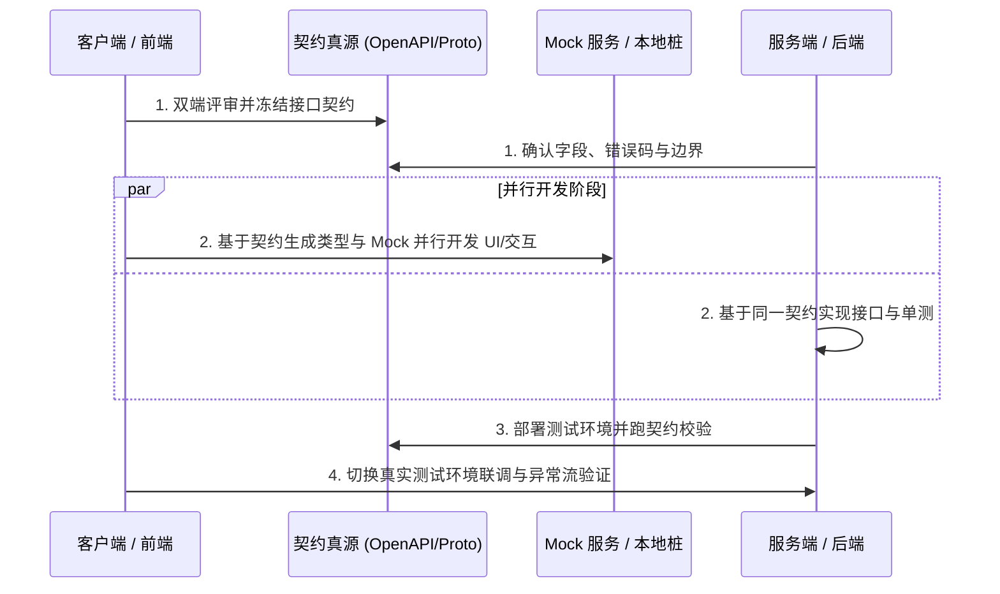

# 03 - 跨端接口契约与联调规范

> - 🟢 本文件适用于所有前后端分离、客户端与服务端（如 Unity/XR、Web、桌面端、移动端对接 Go/Java/Python/Node 后端）或跨服务协作项目的接口定义、变更评审与并行联调。
> - 🔴 不适用：强行覆盖目标项目已有的接口包体格式、字段命名风格、通信协议栈（REST / gRPC / WebSocket）或企业网关统一规范。

---

## 1. 契约先行与单一真源

### 1.1 先定契约、再写代码

- 🔴 **编码前冻结接口契约**：跨端需求进入实现前，客户端与服务端必须共同评审并落盘一份结构化接口契约（如 OpenAPI 3.x YAML/JSON、Protobuf `.proto`、JSON Schema 或仓库统一的接口契约文档），明确路径/事件名、请求与响应字段类型、必填/可空性、枚举值、错误码与鉴权方式。
- 🔴 **禁止口头联调与代码即文档**：严禁服务端写完代码后仅靠口头说明或贴零散抓包截图让客户端猜测字段；同样禁止客户端未经确认擅自假设字段结构写死逻辑再倒逼后端。
- 🔴 **契约与代码同步更新**：接口字段、状态码或业务前置条件发生调整时，必须在同一变更/PR 中更新契约真源，并显式通知所有消费端。

### 1.2 协议选型边界

| 通信形态 | 典型场景 | 契约载体示例 | 协同原则 |
|---|---|---|---|
| **HTTP / REST（JSON）** | 登录鉴权、业务增删改查、配置拉取、资源列表 | OpenAPI 3.x / JSON Schema | 路径语义清晰、状态码规范、幂等明确 |
| **WebSocket / 长连接** | 实时通知、房间事件、协同状态推送、AI 流式输出 | 消息信封表 + 事件 Schema | 必须定义消息类型、序号、心跳与断线补拉 |
| **gRPC / Protobuf** | 内部微服务高频调用、强类型跨语言 RPC | `.proto` 文件（单一真源） | 严禁复用已废弃字段编号（Field Tag） |
| **实时同步协议（UDP / 引擎网络框架）** | 多人 XR/游戏高频位姿与状态同步 | 协议结构定义与同步频率表 | 明确权威端（Server / Host）、插值与丢包补偿 |

🟡 **沿用项目既有协议栈**：不要在同一模块里无故混用多套风格迥异的传输约定。

## 2. 跨端数据格式与字段对齐规范

### 2.1 字段命名与类型红线

- 🔴 **同一接口体系内字段命名风格必须唯一**：全链路统一 `camelCase` 或 `snake_case`（无既有约定时，JSON API 推荐统一 `camelCase` 或随仓库主规范锁定），严禁同一接口里混用 `userId`、`user_name`、`CreateTime`。
- 🔴 **64 位整数与高精度金额防精度丢失**：面向 JavaScript / Web / JSON 消费端时，超过安全整数范围（`2^53 - 1`）的雪花 ID、长整型主键**必须以字符串传输**；涉及金额、费率与计费数量**严禁使用 `float` / `double` 传输**，必须使用整数最小单位（如“分”）或定点数字符串（如 `"19.90"`）。
- 🔴 **空值、空集合与容错语义显式约定**：契约中明确标注每个字段是否可为 `null` 或省略；列表为空时按约定稳定返回 `[]` 而非在 `[]` 与 `null` 间摇摆。客户端反序列化时必须**忽略未知新增字段**并对未知枚举值做安全兜底，防止服务端灰度新增字段直接引发客户端崩溃。
- 🔴 **枚举必须语义明确且稳定**：优先使用大写下划线字符串枚举（如 `"PENDING"`、`"COMPLETED"`）；若采用数字枚举，必须在契约中冻结数值映射并注明不得复用已废弃数值，禁止无说明的魔法数字。

### 2.2 时间、时区与分页统一口径

- 🔴 **时间字段必须自带明确时区与单位**：统一采用 RFC 3339 / ISO-8601 带时区字符串（如 `"2026-11-24T14:30:00Z"` 或 `"2026-11-24T22:30:00+08:00"`），或带明确单位后缀的 UTC 整数时间戳（如 `createdAtMs` 表示毫秒）；**严禁传递无时区的模糊字符串（如 `"2026-11-24 22:30:00"`）或秒/毫秒混用**。
- 🟡 **同一项目统一分页模型**：新建接口默认在项目内只锁定一套分页风格，避免同一系统并存 `list`、`rows`、`records`、`dataList` 等多种键名：
  - 偏移分页（后台管理、常规列表）：请求 `page`、`pageSize`；响应 `items`、`total`、`page`、`pageSize`、`hasMore`。
  - 游标分页（高频写入流、消息/日志流）：请求 `cursor`、`limit`；响应 `items`、`nextCursor`、`hasMore`。

```json
// ❌ 反例：命名混杂、无时区时间、64 位 ID 裸传数字、金额用浮点、魔法数字状态
{
  "user_id": 900719925474099312,
  "userName": "alice",
  "balance": 19.900000000000002,
  "status": 3,
  "createTime": "2026-11-24 22:30:00",
  "rows": null
}

// ✅ 正例：命名统一、长 ID 字符串化、金额用整数分、语义枚举、UTC ISO-8601、明确分页结构
{
  "userId": "900719925474099312",
  "userName": "alice",
  "balanceCents": 1990,
  "status": "ACTIVE",
  "createdAt": "2026-11-24T14:30:00Z",
  "items": [],
  "total": 0,
  "hasMore": false
}
```

## 3. 统一响应包体、错误码与追踪标识

### 3.1 成功与错误响应约定

🟡 **项目内二选一并保持全局一致**（已有网关规范时优先沿用）：
- **标准 REST 风格**：成功直接返回业务数据对象/列表，失败借助标准 HTTP 状态码并返回统一错误体 `{ "code", "message", "requestId", "details?" }`。
- **统一业务包体风格**：所有响应均包在 `{ "code", "message", "data", "requestId" }` 内，成功使用固定成功码（如 `"OK"` 或 `0`）。

- 🔴 **HTTP 状态码语义准确**：鉴权失败（`401`）、权限不足（`403`）、资源不存在（`404`）、参数校验失败（`400`/`422`）、冲突（`409`）、触发限流（`429`）、服务端内部故障（`500`）应清晰区分，便于网关监控、告警统计与客户端统一拦截处理（若历史网关强制统一返回 `HTTP 200`，业务错误码必须具备等价的清晰分级）。
- 🔴 **严禁向客户端泄露内部敏感信息**：错误响应绝不得包含程序堆栈、SQL 语句、数据库连接串、宿主机绝对路径或内部密钥。

### 3.2 业务错误码分级与全链路 `requestId`

- 🟡 **错误码结构化**：推荐按 `<模块>_<原因>`（如 `AUTH_TOKEN_EXPIRED`、`ORDER_OUT_OF_STOCK`）或团队既定数字分段定义，并明确区分**可直接展示给终端用户的提示语**与**仅用于排查的技术上下文**。
- 🔴 **全链路追踪标识必传**：每个服务端响应（响应头 `X-Request-Id` 与错误体 `requestId`）均应携带唯一请求 ID；客户端报错弹窗、日志落盘与提 Bug 时附带该 ID，确保跨端问题可秒级关联服务端日志。

## 4. 幂等性、超时重试与长连接协作

- 🔴 **非幂等写操作必须具备防重机制**：下单、支付、发券、创建不可重复资产或异步任务提交等写请求，契约中应约定幂等键（如 `Idempotency-Key` 请求头或业务请求单号），确保客户端弱网超时重发时不会产生重复数据。
- 🔴 **客户端超时、取消与克制重试**：
  - 所有网络请求必须设置显式超时与可取消信号（Web 路由切换、桌面弹窗关闭、Unity 场景卸载时及时取消在途请求，避免已销毁对象触发回调崩溃）。
  - 自动重试仅限幂等读请求或携带幂等键的写请求，且应使用带抖动的指数退避（Exponential Backoff + Jitter）；**严禁对 `4xx` 业务/参数错误循环重试**。
- 🟡 **WebSocket / 长连接必须约定四要素**：
  1. 统一消息信封（如 `type`、`seq`/`msgId`、`timestampMs`、`payload`）。
  2. 双向心跳间隔与失联超时阈值。
  3. 断线重连退避策略（避免服务端重启瞬间引发雪崩重连）。
  4. 重连后的**状态同步与补拉机制**（增量按 `seq` 补拉或全量快照校准），防止断网期间丢事件导致客户端画面与服务端状态永久不一致。

## 5. 契约变更、向下兼容与并行联调流程

### 5.1 并行联调四步法



- 🔴 **联调期间发现缺口先改契约再改代码**：联调中若需增删字段或调整错误码，先更新契约文档并让双端同步确认，严禁私下热改字段造成文档与真实线上行为漂移。
- 🟡 **异常流必须纳入联调清单**：联调不只跑“成功主路径”，必须实测至少包括：参数错误、Token 过期刷新、无权限、空列表、超时断网与重复提交。

### 5.2 接口向下兼容演进红线

当客户端无法与服务端瞬间同步升级时（如移动 App、桌面客户端、Unity/XR 头显与对外开放 API），服务端接口演进必须遵守 [02 - 软件版本迭代与发布管理规范](./02-软件版本迭代与发布管理规范.md) 的多端兼容原则：

| 变更类型 | 是否兼容旧客户端 | 正确处理方式 |
|---|---|---|
| 响应新增可选字段 | ✅ 兼容 | 直接新增；客户端反序列化忽略未知字段 |
| 请求新增带默认值的可选参数 | ✅ 兼容 | 服务端在旧客户端未传时走默认行为 |
| 删除响应字段 / 修改字段名或类型 | ❌ **破坏性变更** | 禁止原地修改；新增新字段并双写过渡，或升级 `/api/v2/` |
| 把原有可选请求参数改为必填 | ❌ **破坏性变更** | 禁止原地收紧；旧版客户端未传时保留默认兼容行为 |
| 改变已有枚举值或错误码含义 | ❌ **破坏性变更** | 新增枚举值/错误码，旧值保留语义直至废弃下线 |

## 6. 接口交付与联调自检清单

跨端接口提测或上线前逐项核对：

- [ ] 契约文件（OpenAPI / Proto / Schema）是否已落盘评审，且与当前实现完全一致
- [ ] 字段命名风格、64 位 ID/金额类型、时区时间格式、分页结构与枚举值是否全链路统一
- [ ] 错误响应是否具备清晰状态码、业务错误码、用户提示与 `requestId`，且未泄露堆栈/敏感信息
- [ ] 核心写接口是否具备幂等保护，客户端是否配置超时、页面/场景卸载取消与合理重试策略
- [ ] 长连接接口是否已验证心跳、断线重连与重连后状态校准
- [ ] 接口修改是否对仍在活跃的旧版客户端保持向下兼容（无静默破坏性变更）
- [ ] 联调是否覆盖成功主路径与关键异常流（鉴权过期、空态、参数校验失败、超时断网）
