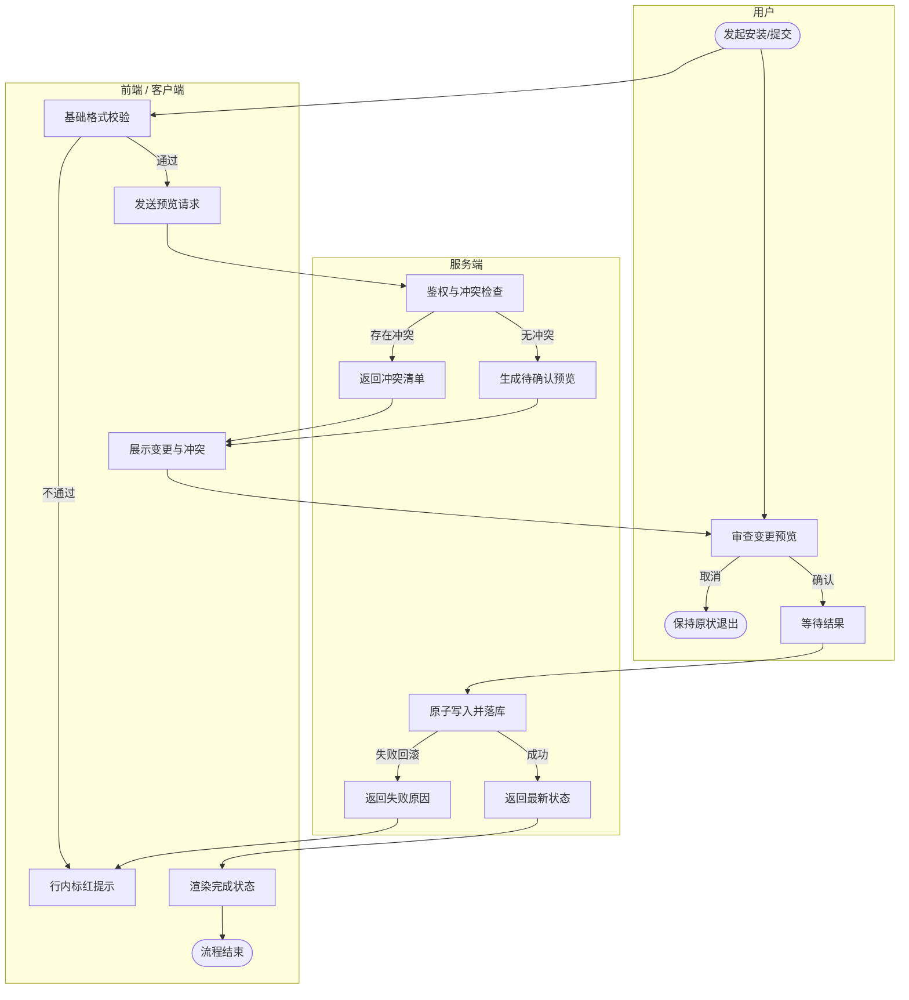

# 02 - PRD 编写与状态流程规则

> - 🟢 本文件适用于新功能与迭代需求的 PRD 编写、业务流程建模、状态流转定义、异常覆盖与验收标准编写。
> - 🔴 不适用：替代详细技术架构设计文档、数据库物理建模或 UI 视觉标注稿。

---

## 1. PRD 最小完整结构

根据需求规模裁剪章节，但正式功能 PRD 必须能直接回答以下 6 个核心问题：

1. **背景与目标**：解决什么问题、现状事实是什么、成功衡量口径是什么。
2. **范围与优先级**：本期做什么（P0/P1）、明确不做什么。
3. **角色、权限与作用域**：涉及哪些用户角色、数据归属（本机 / 项目级 / 企业级）及权限边界。
4. **业务流程与交互逻辑**：端到端主流程、前置条件、分支条件与关键状态机。
5. **功能详述与异常规则**：页面/接口的核心字段、输入校验、空态、加载态、冲突与失败恢复。
6. **非功能约束与验收标准**：性能/安全/隐私底线（如密钥脱敏、防误覆盖）及逐条可测验收条件。

- 🔴 现状诊断与规划目标必须分栏或显式标注，避免研发与测试误以为文档中所有描述均为已实现能力。
- 🟡 优先使用表格、状态转移表与简洁流程图（如 Mermaid）表达复杂规则，避免大段散文式叙述。

## 2. 业务流程、泳道图与状态机规范

### 2.1 产品侧图型选型与边界

在画图前先按“要回答的问题”选对图型，避免一张图混装所有信息：

| 需表达的问题 | 应选用图型 | 核心边界 |
|---|---|---|
| 页面里有什么控件、列表字段、点击去哪 | **产品结构图（XMind）** | 纯用户可见界面结构，写法见 [01 §3](./01-需求范围与产品结构规则.md#3-信息架构与产品结构图规范) |
| 单角色/单端任务的步骤与判断分支 | **业务流程图（Flowchart）** | 聚焦单条业务主线、分支与异常回退 |
| 多角色或双端（前端+后端 / 客户端+服务端 / 外部系统）分工协作 | **跨端泳道图（Swimlane）** | 明确每一步归哪个端/角色执行、跨端传递什么与异常谁兜底 |
| 核心业务对象（如订单/任务/房间）生命周期流转 | **状态机图（State Diagram）** | 明确全部合法状态、触发事件与非法状态拦截 |
| 系统静态分层、模块部署与精确接口协议 | **系统架构图 / 时序图** | 归研发技术文档维护；产品侧不拿泳道图冒充系统架构图 |

### 2.2 流程图与跨端泳道图制作规范

- 🔴 **一图一事，严控复杂度**：每张图只讲清楚一条核心业务流程（节点建议控制在 10–25 个以内）；超长业务拆为「主干流程图 + 子流程图」，严禁把整款产品的所有分支塞进一张蜘蛛网大图。
- 🔴 **双端/多角色必分泳道**：只要涉及前端与后端、客户端与服务端或外部第三方协作，必须按真实责任主体划分泳道（常见双端划分：`用户` \| `前端 / 客户端` \| `服务端` \| `外部系统`）。每个动作节点只归属一个泳道，跨泳道连线必须标明触发动作或传递的关键数据，清晰划分“客户端校验 vs 服务端鉴权/落库”的责任边界。
- 🔴 **图元语义规范与零死胡同**：
  - **起止点**（圆角胶囊）：流程必须有明确起点与出口（完成、取消或报错退出），严禁出现无出线的断头节点；
  - **动作节点**（矩形）：使用简短**动宾短语**（如 `校验本地冲突`、`写入受管文件`），术语与 PRD 及产品结构图 1:1 一致，不写长段散文；
  - **判断节点**（菱形）：每条分支出线必须标清互斥条件（如 `通过` / `失败`），**严禁只画成功主干而遗漏“失败 / 拒绝 / 超时 / 取消”回退路径**。
- 🟡 **统一阅读主轴**：整张图保持单一主方向（自上而下或从左到右），尽量减少连线交叉与大跨度逆向回环；优先采用可版本化编辑的载体（如 Mermaid `flowchart` + `subgraph` 泳道、FigJam、Draw.io）。

❌ 反例：双端业务不划泳道，把用户点击、前端弹窗、后端写库、第三方回调全混成一列矩形框；判断框只画“是”不画“否”和断网处理，甚至把泳道图当成系统架构图交付研发。

✅ 正例：按责任主体拆清泳道，每条分支均有条件与异常出口：

### 2.3 业务状态与异常完整性

| 维度 | 必须明确的内容 | 常见遗漏点 |
|---|---|---|
| **对象生命周期** | 创建 → 运行/生效 → 更新/变更 → 停用/冲突 → 删除/卸载 | 只写“新增”，漏写“更新冲突”与“卸载后保留什么” |
| **交互与数据状态** | 初始空态、加载中、正常有数据、搜索无结果、部分失败、全量失败 | 漏写首次打开空态、长文本溢出、离线不可用态 |
| **并发与中断** | 重复点击防抖、多窗口/多进程冲突锁、写入中途断电或强制退出的恢复路径 | 假设操作永远一次成功且瞬间完成 |
| **权限与安全** | 越权拦截、外部导入安全扫描、敏感凭证存储位置与脱敏展示 | 把本机密钥混入可共享配置或明文日志 |

- 🔴 任何涉及**修改用户已有文件、配置或关键数据**的操作，必须明确是否需要“变更前预览确认”及“冲突时阻断策略”，严禁静默覆盖。
- 🔴 区分**逻辑状态**（如已停用、有更新、配置冲突）与**操作结果**（成功/失败提示），并明确失败后表单或原状态如何保留。
- 🔴 **交互入口交接覆盖表（零悬空入口）**：PRD 交付给 UI 设计前，必须梳理本版本所有核心页面入口、分段开关与高风险按钮对应的目标落点（独立页 / 抽屉 / 弹窗 / 原地反馈态）及操作后结果态（进行中 / 成功 / 失败 / 多目标部分失败），避免下游只画主页面而遗漏二级流程。

## 3. 数据口径与字段定义

- 🔴 涉及统计数字（如项目数、已安装数、异常数、完成率）时，必须写明统计口径、去重规则与刷新时机，确保侧边栏徽章、列表头与明细行数字一致。
- 🔴 涉及版本、来源或外部输入字段时，明确必填/选填、格式约束、长度上限、默认值与非法输入提示。

## 4. 可观测验收标准（Acceptance Criteria）

- 🔴 每条核心功能必须配有可执行的验收条件，推荐采用 **“前置条件 + 触发动作 + 可观测预期结果”** 结构。
- 🔴 验收标准必须覆盖至少一条**正向路径**和关键**负向/拦截路径**（如非法输入、权限不足、文件冲突、网络断开）。

❌ 反例：“安装流程稳定可靠，错误提示友好清晰，性能流畅。”

✅ 正例：
- 正向：选择 2 个已检测 AI 工具并点击「确认安装」后，两个目标配置目录均写入受管文件，列表状态更新为「正常」，已安装计数同步加 1。
- 负向：目标路径存在同名未知文件时，预览阶段红框标出冲突文件路径且「确认安装」按钮禁用，确认不修改原文件。

## 5. 高频协同产物最小标准模板

### 5.1 会议纪要转待办标准结构

将口头讨论或会议纪要转为可执行输出时，固定拆为三张极简表（缺失字段填 `待定`，禁止编造人名或日期）：

1. **已拍板决策**：`| 编号 | 决策结论 | 影响范围 | 决策依据 |`
2. **明确行动项（待办）**：`| 编号 | 事项 | 负责人 | 交付产物 | 截止时间 | 依赖/阻塞 |`
3. **仍待讨论议题**：`| 编号 | 未决问题 | 候选方案与利弊 | 需拍板角色 |`

### 5.2 版本验收用例表标准结构

| 编号 | 所属模块/场景 | 路径类型 | 前置条件 | 触发动作 | 可观测预期结果 | 结论与证据 |
|---|---|---|---|---|---|---|
| `AC-01` | <模块/页面> | 正向 / 负向拦截 | <初始状态与数据> | <具体操作> | <界面状态、落盘结果或拦截提示> | 通过 / 失败 / 未测（附实测环境） |
