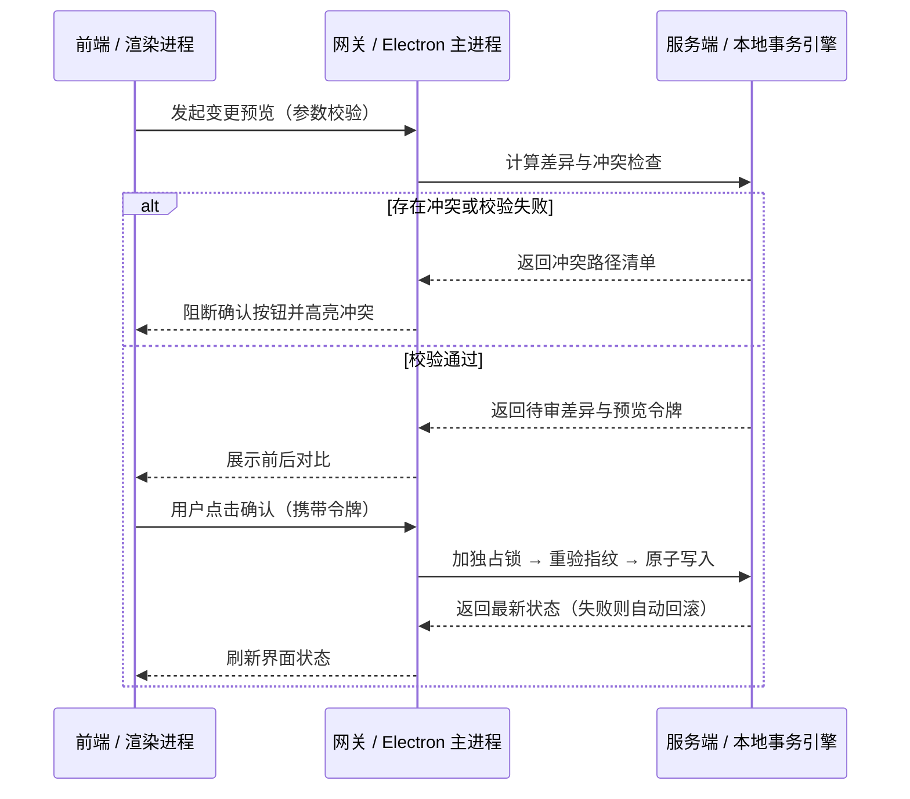

# 02 - JS+TS 技术文档编写规范

> - 🟢 本文件适用于 JS+TS 工程、模块、接口、数据、测试、运行和 ADR 正文。
> - 🔴 不适用：将框架、依赖、命令或性能结论写成没有证据的项目事实。

---

## 1. 写作要求

- 🔴 先说明项目或模块解决的问题、用途、范围和当前结论，再展开实现细节；保留必要前置知识。
- 🔴 每段只表达一个意思；使用短段落、列表和必要表格，删除重复背景与空话。
- 🔴 易变数值、完整接口签名、配置和 schema 指向权威来源；只在解释调用约束时使用必要片段，不复制第二份真相。
- 🔴 无证据的内容标记为待确认；计划、设计建议与当前实现分别表述，不从目录名或依赖名称推断项目能力。
- 🟡 复杂的模块关系、调用或数据流可用 Mermaid；图中节点和连线必须有对应来源，标明调用、事件或数据关系。

## 2. 正文边界与归类

- 🔴 一篇正文回答一个可独立检索的技术问题；标题、用途、范围和来源与所在主题一致。
- 🔴 按 [组织与维护规范](./01-技术文档组织与维护规范.md) 复用现有文档；同一事实保持一个维护位置，其他页面使用摘要与链接。
- 🔴 技术文档可解释项目用途和已实现能力，但不代替产品需求、交互/视觉设计、运营或管理文档。
- 🟡 简短内容可保留在总览或模块正文中；复杂架构、独立流程和契约有实际维护需要时再拆分。

## 3. 仓库理解与内容深度

### 3.1 读者应能回答的问题

以下是内容覆盖要求，按本次范围和项目规模组织，不要求每行单独生成一篇文档。

| 读者问题 | 正文应说明 | 主要证据 |
|---|---|---|
| 项目做什么 | 用途、主要能力、系统边界、已实现与未覆盖范围 | 对外入口、实际行为、现有说明与测试 |
| 整体如何组织 | 运行单元、模块职责、进程或部署边界、内部与外部依赖 | 工作区、构建配置、入口和调用关系 |
| 如何启动 | 启动入口、初始化顺序、配置加载、组件或服务注册 | 启动代码、路由/依赖注入注册、配置绑定和启动记录 |
| 一个功能怎样完成 | 触发条件、入口、协作模块、数据与状态变化、结果和失败路径 | 真实调用、事件处理、数据读写及相关测试 |
| 关键代码在哪里 | 核心符号的路径、职责、输入输出、调用方和副作用 | 定义、实际使用位置、契约和测试 |
| 如何运行和验证 | 环境、工作目录、命令或脚本操作、预期结果、排障和验证状态 | 依赖配置、脚本、CI、测试与执行记录 |
| 修改会影响什么 | 跨模块契约、状态与资源归属、兼容性、关联测试和已知限制 | 类型或数据定义、消费者、迁移及决策记录 |

### 3.2 关键类、函数与组件

- 🔴 优先说明公共入口、主要流程协调者、状态或资源所有者、契约边界和关键算法；以对理解或修改功能的重要性选择，不逐项抄录全部声明。
- 🔴 对选中的符号写清所属路径与稳定名称、职责、关键输入输出、实际调用方或触发方式；有副作用、错误、并发或生命周期约束时一并说明。
- 🔴 通过调用位置、路由/依赖注入注册、配置绑定或测试核对其作用；存在定义不代表已经接入运行路径。
- 🟡 简单 getter、转发包装和通用工具函数通常通过源码链接定位；只有影响行为理解时才展开。

### 3.3 调用链、数据流与依赖

- 🔴 核心链路从真实触发点追踪到结果：入口 → 协作模块 → 数据或外部服务 → 返回、状态变化与资源清理，并记录关键失败或取消路径。
- 🔴 区分直接调用、异步任务、事件订阅、配置注入及跨进程通信；静态导入只能证明代码依赖，不能单独证明运行顺序或实际调用。
- 🔴 说明数据由谁产生、校验、保存和消费，状态或资源由谁拥有；不把函数名称列表当作流程说明。
- 🔴 内部依赖写明方向和协作目的；外部依赖写明使用模块、实际用途及必要约束，版本与完整列表链接到依赖清单或锁文件。

❌ 反例：仅根据目录名写“该模块负责数据管理”，或把所有依赖逐项翻译成中文。

✅ 正例：沿已核查入口说明由哪个符号接收数据、谁校验与保存、结果交给谁，以及相应源码和测试位置。

### 3.4 系统架构图与时序图规范

研发技术文档必须区分**静态架构**与**动态交互**，按场景选图，严禁拿业务泳道图冒充系统架构图：

| 图类型 | 解决的问题 | 适用场景 |
|---|---|---|
| **系统架构图**（分层 / 边界框图） | 系统由哪些端、进程、模块和外部系统组成，依赖与通信边界在哪 | `01-技术总览.md`、架构设计、双端/多端集成（如前端 + 后端、Electron 主/渲染进程 + CLI） |
| **时序图**（`sequenceDiagram`） | 跨端/异步调用的精确先后顺序、协议、超时重试与失败回滚 | 鉴权刷新、支付/Webhook 回调、文件事务写入、断线重连、多端状态同步 |

- 🔴 **系统架构图 4 项硬要求**：
  1. **显式标出运行与进程边界**：使用分组框（如 Mermaid `subgraph`）区分浏览器/桌面渲染进程、主进程/BFF、后端服务、本地子进程、数据库/缓存与第三方外部系统，禁止把跨网络/跨进程调用画成同进程依赖。
  2. **连线标明协议与流向**：每条跨边界连线必须标注实际协议或通信机制（如 `HTTPS/REST`、`WebSocket`、`IPC`、`stdio`、`SQL`、`本地文件`）及方向，禁止画无语义裸箭头。
  3. **标注安全与信任边界（适用时）**：涉及鉴权网关、IPC 发送方校验、只读/写入隔离或本机敏感凭证时，在架构图中标清边界。
  4. **严格忠于源码与配置**：节点与连线必须可追溯到真实代码、依赖或部署配置；**规划中/未实现模块必须显式标注“规划”或与现状分图**，严禁臆造不存在的网关、消息队列或数据库。
- 🔴 **时序图 4 项硬要求**：
  1. **按调用发起顺序排列参与方**：从左到右排列真实参与方（如 `渲染进程 / 前端` → `主进程 / 网关` → `业务服务` → `存储 / 第三方`），禁止省略中间转发或安全校验层。
  2. **区分同步与异步消息**：同步请求/返回使用实线请求 + 虚线返回，事件推送/异步回调明确标注方向与触发源，并在消息上写清真实接口路径、IPC 通道名或事件名。
  3. **必须画清异常、超时与回滚分支**：使用 `alt` / `else` 或 `opt` 显式标出鉴权失败、冲突拦截、超时重试或事务回滚路径，严禁只画理想“一路成功”主干。
  4. **标注状态与资源归属**：涉及加锁、取消信号（`AbortController`）或幂等键时，用 `Note` 标明生效与释放时机。
- 🟡 **单图控复杂度**：架构图单图控制在 8–18 个核心节点、时序图聚焦单条关键链路（通常 4–6 个参与方）；系统庞大时按「系统上下文图 → 容器/端间架构图 → 局部模块图」分层下钻，不把几十个工具类堆进一张图。

## 4. JS+TS 事实检查

| 主题 | 优先来源 |
|---|---|
| 运行时与依赖 | `package.json`（含 `exports`/`bin`/工作区定义）、锁文件、Node/浏览器/桌面运行时配置 |
| 类型与构建 | `tsconfig*.json`（含继承链与项目引用）、构建配置、脚本、工作区包依赖与现有应用/包结构 |
| 配置与数据 | 环境变量 schema、配置文件、本地文件/锁文件格式、迁移、浏览器存储和数据定义 |
| 契约 | OpenAPI、事件定义、共享类型、客户端/服务端契约、Electron IPC（`main`/`preload`/`renderer`）通道、CLI 参数/退出码与 JSON Schema |
| 质量与运行 | 测试配置、日志、错误上报、性能记录、CI 和部署/打包配置 |

- 🔴 涉及 Promise、任务取消、订阅、定时器、事件监听或资源时，说明创建方、所有者、取消/清理时机和错误路径。
- 🔴 涉及 HTTP、事件、浏览器存储、服务端数据、桌面端/Electron IPC 通道、CLI 参数与输出、本地文件/锁文件或 JSON Schema 契约时，说明提供方、消费方、兼容性和权威定义。
- 🔴 构建与排障步骤写清前置条件、操作、预期结果、失败处理和验证点。
- 🔴 禁止默认使用 React、Vue、Next.js、Vite、Webpack、Node 框架或测试工具；以项目证据为准。
- 🔴 入口追踪重点：浏览器入口、路由、服务端启动、桌面端/Electron（`main`/`preload`/`renderer` 及 IPC 通道）、CLI 命令（`bin` 入口）、Monorepo 工作区包导出（`exports`）与包依赖、任务与事件注册；区分浏览器、服务端、桌面主进程/渲染进程和其他运行进程。

## 5. 来源、验证与文档状态

- 🔴 关键结论就近标出项目内相对路径与稳定符号，运行结论关联实际命令或操作记录；复杂关系同时标明定义和使用位置，不仅在文末泛列目录。
- 🔴 首次或整体分析说明源码基线与覆盖范围；源码、发布版本、安装产物或多个工作树不一致时分别说明，不混用证据。
- 🔴 区分“源码或配置已核对”“已运行验证”“待确认/未验证”。说明运行条件与观察结果；存在测试不代表测试已通过，构建成功不代表端到端行为或目标设备已验证。
- 🔴 实现关系可由代码核查；设计动机和历史取舍需要 ADR、提交说明或责任人确认。没有依据时说明未知，不替作者编造原因。
- 🔴 文档状态按组织规范管理。`有效` 表示内容反映当前已核查事实，不代表所有运行场景都已实测；运行验证状态在对应条目中单独记录。
- 🔴 环境变量和认证步骤只写名称、用途及安全的示例或获取方式，不把密钥、个人凭据或真实业务数据复制进文档。

## 6. 完成前自检

- [ ] 读者能从总览找到入口、主要模块、核心链路以及运行方式。
- [ ] 本次范围内的主要能力有源码与文档对应，未覆盖项已说明。
- [ ] 关键符号解释了协作和行为，依赖与流程没有仅按名称猜测。
- [ ] 涉及多端、多进程或复杂异步链路时，架构图已标清进程/协议/现状边界，时序图已覆盖异常与回滚分支。
- [ ] 异步、事件、状态、资源清理和兼容性边界在适用时已说明。
- [ ] 关键结论可定位到来源，源码核查与运行验证没有混淆。
- [ ] 正文位置、索引、链接、状态和文档变更记录已同步，无空章节或重复正文。
