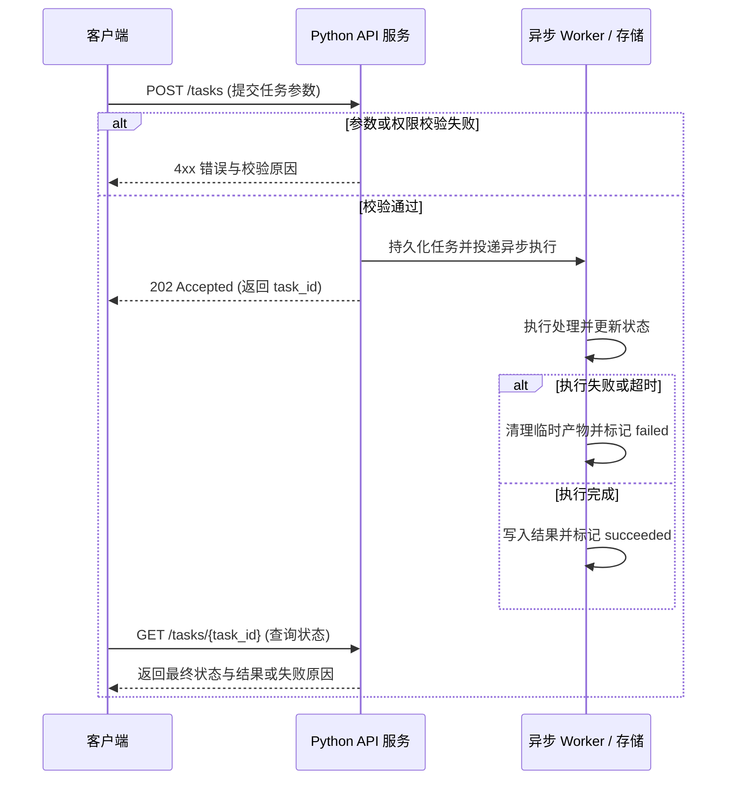

# 02 - Python 技术文档编写规范

> - 🟢 本文件适用于 Python 工程、模块、接口、数据、测试、运行和 ADR 正文。
> - 🔴 不适用：将框架、依赖、命令或性能结论写成没有证据的项目事实。

---

## 1. 写作要求

- 🔴 先说明项目或模块解决的问题、用途、范围和当前结论，再展开实现细节；保留必要前置知识。
- 🔴 每段只表达一个意思；使用短段落、列表和必要表格，删除重复背景与空话。
- 🔴 易变数值、完整接口签名、配置和 schema 指向权威来源；只在解释调用约束时使用必要片段，不复制第二份真相。
- 🔴 无证据的内容标记为待确认；计划、设计建议与当前实现分别表述，不从目录名或依赖名称推断项目能力。
- 🟡 复杂的模块关系、调用或数据流可用 Mermaid；图中节点和连线必须有对应来源，标明调用、事件或数据关系。

## 2. 正文边界与归类

- 🔴 一篇正文回答一个可独立检索的技术问题；标题、用途、范围和来源与所在主题一致。
- 🔴 按 [组织与维护规范](./01-技术文档组织与维护规范.md) 复用现有文档；同一事实保持一个维护位置，其他页面使用摘要与链接。
- 🔴 技术文档可解释项目用途和已实现能力，但不代替产品需求、交互/视觉设计、运营或管理文档。
- 🟡 简短内容可保留在总览或模块正文中；复杂架构、独立流程和契约有实际维护需要时再拆分。

## 3. 仓库理解与内容深度

### 3.1 读者应能回答的问题

以下是内容覆盖要求，按本次范围和项目规模组织，不要求每行单独生成一篇文档。

| 读者问题 | 正文应说明 | 主要证据 |
|---|---|---|
| 项目做什么 | 用途、主要能力、系统边界、已实现与未覆盖范围 | 对外入口、实际行为、现有说明与测试 |
| 整体如何组织 | 运行单元、模块职责、进程或部署边界、内部与外部依赖 | 工作区、构建配置、入口和调用关系 |
| 如何启动 | 启动入口、初始化顺序、配置加载、组件或服务注册 | 启动代码、路由/依赖注入注册、配置绑定和启动记录 |
| 一个功能怎样完成 | 触发条件、入口、协作模块、数据与状态变化、结果和失败路径 | 真实调用、事件处理、数据读写及相关测试 |
| 关键代码在哪里 | 核心符号的路径、职责、输入输出、调用方和副作用 | 定义、实际使用位置、契约和测试 |
| 如何运行和验证 | 环境、工作目录、命令或脚本操作、预期结果、排障和验证状态 | 依赖配置、脚本、CI、测试与执行记录 |
| 修改会影响什么 | 跨模块契约、状态与资源归属、兼容性、关联测试和已知限制 | 类型或数据定义、消费者、迁移及决策记录 |

### 3.2 关键类、函数与组件

- 🔴 优先说明公共入口、主要流程协调者、状态或资源所有者、契约边界和关键算法；以对理解或修改功能的重要性选择，不逐项抄录全部声明。
- 🔴 对选中的符号写清所属路径与稳定名称、职责、关键输入输出、实际调用方或触发方式；有副作用、错误、并发或生命周期约束时一并说明。
- 🔴 通过调用位置、路由/依赖注入注册、配置绑定或测试核对其作用；存在定义不代表已经接入运行路径。
- 🟡 简单 getter、转发包装和通用工具函数通常通过源码链接定位；只有影响行为理解时才展开。

### 3.3 调用链、数据流与依赖

- 🔴 核心链路从真实触发点追踪到结果：入口 → 协作模块 → 数据或外部服务 → 返回、状态变化与资源清理，并记录关键失败或取消路径。
- 🔴 区分直接调用、异步任务、事件订阅、配置注入及跨进程通信；静态导入只能证明代码依赖，不能单独证明运行顺序或实际调用。
- 🔴 说明数据由谁产生、校验、保存和消费，状态或资源由谁拥有；不把函数名称列表当作流程说明。
- 🔴 内部依赖写明方向和协作目的；外部依赖写明使用模块、实际用途及必要约束，版本与完整列表链接到依赖清单或锁文件。

❌ 反例：仅根据目录名写“该模块负责数据管理”，或把所有依赖逐项翻译成中文。

✅ 正例：沿已核查入口说明由哪个符号接收数据、谁校验与保存、结果交给谁，以及相应源码和测试位置。

### 3.4 系统架构图与时序图规范

技术文档必须区分**静态系统结构**与**跨端动态通信**，严禁拿业务泳道图冒充系统架构图：

| 图类型 | 解决的问题 | 适用场景 |
|---|---|---|
| **系统架构图**（分层 / 边界框图） | 客户端、Python Web/API 服务、异步 Worker、模型/数据存储与外部系统如何划分与连接 | `01-技术总览.md`、架构设计、双端服务与数据/AI 推理管线 |
| **时序图**（`sequenceDiagram`） | 跨端接口请求、异步任务提交/轮询/回调、超时与失败回滚精确顺序 | 鉴权、异步作业调度、Webhook 回调、外部模型/API 调用与降级 |

- 🔴 **系统架构图 4 项硬要求**：
  1. **显式标出部署与进程边界**：用分组框（如 Mermaid `subgraph`）区分客户端、API 服务、异步 Worker / 定时任务、数据库/对象存储与外部服务（如第三方模型/API），禁止把独立任务进程画成同进程函数调用。
  2. **连线标明协议与流向**：跨边界连线必须标注通信协议（如 `HTTPS/REST`、`WebSocket`、`gRPC`、`SQL`、`队列消息`、`本地文件`）及方向，禁止画无含义裸箭头。
  3. **标注安全与隔离边界（适用时）**：标明鉴权入口、敏感凭证注入边界及外部不可信输入校验点。
  4. **严格忠于源码与配置**：节点和连线必须对应真实模块、服务或配置；**规划中/未实现组件必须显式标注“规划”或与现状分图**，禁止臆造不存在的中间件或队列。
- 🔴 **时序图 4 项硬要求**：
  1. **按真实调用链排列参与方**：从左到右排列真实参与方（如 `客户端` → `API 服务` → `任务队列 / Worker` → `存储 / 外部 API`），不跳过中间调度层。
  2. **区分同步请求与异步任务**：同步请求用实线请求 + 虚线响应，异步入队、轮询或回调明确标出任务 ID、状态转换与触发方。
  3. **覆盖异常、超时与失败清理路径**：使用 `alt` / `else` 标明校验拒绝、外部调用超时、重试上限耗尽或资源清理路径，严禁只画理想成功主干。
  4. **标注并发与资源归属**：涉及锁、幂等键、临时文件清理或协程取消时，用 `Note` 注明生效与释放时机。
- 🟡 **单图控复杂度**：架构图单图控制在 8–18 个核心节点、时序图聚焦单条核心链路（4–6 个参与方）；复杂系统按「系统上下文 → 服务容器图 → 模块内部图」分层下钻。

## 4. Python 事实检查

| 主题 | 优先来源 |
|---|---|
| 版本与依赖 | `pyproject.toml`、锁文件、`requirements*.txt`、虚拟环境说明 |
| 包与模块边界 | `src/`、包结构、入口脚本、导入关系和现有实现 |
| 配置与数据 | 配置文件、环境变量说明、迁移文件和存储 schema |
| 契约 | OpenAPI、消息定义、Pydantic/dataclass 模型和迁移代码 |
| 质量与运行 | 测试、日志、指标、追踪、容器/部署配置和运行记录 |

- 🔴 涉及协程、后台任务、连接、文件或上下文管理器时，说明创建方、所有者、取消/关闭时机和错误路径。
- 🔴 涉及 API、消息或数据库时，说明提供方、消费方、兼容性和权威定义。
- 🔴 构建与排障步骤写清前置条件、操作、预期结果、失败处理和验证点。
- 🔴 禁止默认使用 Django、FastAPI、Flask、Celery、ORM 或包管理工具；以项目证据为准。
- 🔴 入口追踪重点：包入口、命令行、服务启动、路由注册、后台任务与导入关系；区分同进程调用与独立任务。

## 5. 来源、验证与文档状态

- 🔴 关键结论就近标出项目内相对路径与稳定符号，运行结论关联实际命令或操作记录；复杂关系同时标明定义和使用位置，不仅在文末泛列目录。
- 🔴 首次或整体分析说明源码基线与覆盖范围；源码、发布版本、安装产物或多个工作树不一致时分别说明，不混用证据。
- 🔴 区分“源码或配置已核对”“已运行验证”“待确认/未验证”。说明运行条件与观察结果；存在测试不代表测试已通过，构建成功不代表端到端行为或目标设备已验证。
- 🔴 实现关系可由代码核查；设计动机和历史取舍需要 ADR、提交说明或责任人确认。没有依据时说明未知，不替作者编造原因。
- 🔴 文档状态按组织规范管理。`有效` 表示内容反映当前已核查事实，不代表所有运行场景都已实测；运行验证状态在对应条目中单独记录。
- 🔴 环境变量和认证步骤只写名称、用途及安全的示例或获取方式，不把密钥、个人凭据或真实业务数据复制进文档。

## 6. 完成前自检

- [ ] 读者能从总览找到入口、主要模块、核心链路以及运行方式。
- [ ] 本次范围内的主要能力有源码与文档对应，未覆盖项已说明。
- [ ] 关键符号解释了协作和行为，依赖与流程没有仅按名称猜测。
- [ ] 涉及多端、多进程或复杂异步链路时，架构图已标清部署/协议/现状边界，时序图已覆盖超时与失败清理分支。
- [ ] 协程、资源、上下文管理和兼容性边界在适用时已说明。
- [ ] 关键结论可定位到来源，源码核查与运行验证没有混淆。
- [ ] 正文位置、索引、链接、状态和文档变更记录已同步，无空章节或重复正文。
