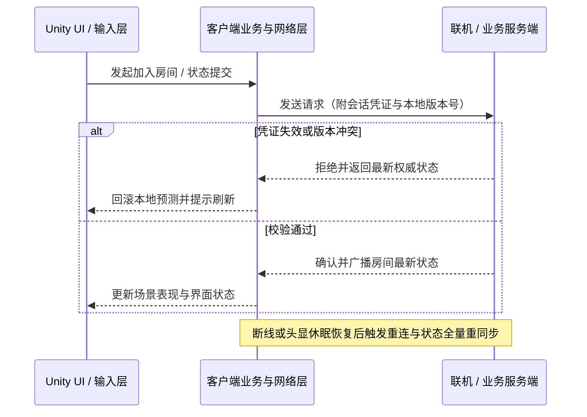

# 02 - Unity 技术文档编写规范

> - 🟢 本文件适用于 Unity 工程、模块、接口、数据、测试、运行维护和 ADR 的技术正文。
> - 🔴 不适用：将通用 Unity 经验、未经确认的方案或其他角色的结论写成项目事实。

---

## 1. 写作要求

- 🔴 先说明项目或模块解决的问题、用途、范围和当前结论，再展开实现细节；保留必要前置知识。
- 🔴 每段只表达一个意思；使用短段落、列表和必要表格，删除重复背景与空话。
- 🔴 易变数值、完整接口签名、配置和 schema 指向权威来源；只在解释调用约束时使用必要片段，不复制第二份真相。
- 🔴 无证据的内容标记为待确认；计划、设计建议与当前实现分别表述，不从目录名或依赖名称推断项目能力。
- 🟡 复杂的模块关系、调用或数据流可用 Mermaid；图中节点和连线必须有对应来源，标明调用、事件或数据关系。

## 2. 正文边界与归类

- 🔴 一篇正文回答一个可独立检索的技术问题；标题、用途、范围和来源与所在主题一致。
- 🔴 按 [组织与维护规范](./01-技术文档组织与维护规范.md) 复用现有文档；同一事实保持一个维护位置，其他页面使用摘要与链接。
- 🔴 技术文档可解释项目用途和已实现能力，但不代替产品需求、策划、美术、运营或管理文档。
- 🟡 简短内容可保留在总览或模块正文中；复杂架构、独立流程和契约有实际维护需要时再拆分。

## 3. 仓库理解与内容深度

### 3.1 读者应能回答的问题

以下是内容覆盖要求，按本次范围和项目规模组织，不要求每行单独生成一篇文档。

| 读者问题 | 正文应说明 | 主要证据 |
|---|---|---|
| 项目做什么 | 用途、主要能力、系统边界、已实现与未覆盖范围 | 对外入口、实际行为、现有说明与测试 |
| 整体如何组织 | 运行单元、模块职责、进程或部署边界、内部与外部依赖 | 工作区、构建配置、入口和调用关系 |
| 如何启动 | 启动入口、初始化顺序、配置加载、组件或服务注册 | 启动代码、注册配置、资源绑定和启动记录 |
| 一个功能怎样完成 | 触发条件、入口、协作模块、数据与状态变化、结果和失败路径 | 真实调用、事件处理、数据读写及相关测试 |
| 关键代码在哪里 | 核心符号的路径、职责、输入输出、调用方和副作用 | 定义、实际使用位置、契约和测试 |
| 如何运行和验证 | 环境、工作目录、命令或编辑器操作、预期结果、排障和验证状态 | 依赖配置、脚本、CI、测试与执行记录 |
| 修改会影响什么 | 跨模块契约、状态与资源归属、兼容性、关联测试和已知限制 | 类型或数据定义、消费者、迁移及决策记录 |

### 3.2 关键类、函数与组件

- 🔴 优先说明公共入口、主要流程协调者、状态或资源所有者、契约边界和关键算法；以对理解或修改功能的重要性选择，不逐项抄录全部声明。
- 🔴 对选中的符号写清所属路径与稳定名称、职责、关键输入输出、实际调用方或触发方式；有副作用、错误、并发或生命周期约束时一并说明。
- 🔴 通过调用位置、注册关系、场景绑定或测试核对其作用；存在定义不代表已经接入运行路径。
- 🟡 简单 getter、转发包装和通用工具函数通常通过源码链接定位；只有影响行为理解时才展开。

### 3.3 调用链、数据流与依赖

- 🔴 核心链路从真实触发点追踪到结果：入口 → 协作模块 → 数据或外部服务 → 返回、状态变化与资源清理，并记录关键失败或取消路径。
- 🔴 区分直接调用、异步任务、事件订阅、配置注入及跨进程通信；静态导入只能证明代码依赖，不能单独证明运行顺序或实际调用。
- 🔴 说明数据由谁产生、校验、保存和消费，状态或资源由谁拥有；不把函数名称列表当作流程说明。
- 🔴 内部依赖写明方向和协作目的；外部依赖写明使用模块、实际用途及必要约束，版本与完整列表链接到依赖清单或锁文件。

❌ 反例：仅根据目录名写“该模块负责数据管理”，或把所有依赖逐项翻译成中文。

✅ 正例：沿已核查入口说明由哪个符号接收数据、谁校验与保存、结果交给谁，以及相应源码和测试位置。

### 3.4 系统架构图与时序图规范

Unity / XR 项目技术文档必须区分**静态系统结构**与**客户端-服务端/异步动态通信**，严禁拿业务泳道图冒充系统架构图：

| 图类型 | 解决的问题 | 适用场景 |
|---|---|---|
| **系统架构图**（分层 / 边界框图） | Unity 客户端子系统、XR SDK/原生插件、资源加载层、后端服务与外部系统的划分与通信边界 | `01-技术总览.md`、架构设计、客户端-服务端双端联调、XR 硬件 SDK 集成 |
| **时序图**（`sequenceDiagram`） | 登录鉴权、多人房间同步、资源热更下载、断线重连与状态恢复的精确先后顺序 | 网络同步、长连接心跳与重连、热更资源加载与释放、摘戴头显恢复同步 |

- 🔴 **系统架构图 4 项硬要求**：
  1. **显式标出运行与端侧边界**：用分组框（如 Mermaid `subgraph`）区分 Unity 客户端（场景/表现层、业务模块、资源与输入抽象层、原生/XR SDK 桥接）与服务端（网关、业务/房间服务、存储与外部服务），禁止把远程网络通信与本地模块调用混为一谈。
  2. **连线标明协议与流向**：跨端或跨层连线必须标注通信机制（如 `HTTPS/REST`、`WebSocket`、`UDP/KCP`、`原生 JNI/Plugin`、`Addressables/YooAsset`、`事件总线`）及方向，禁止画无含义裸箭头。
  3. **标注权威与安全边界（适用时）**：联机或含服务端校验场景须标明状态权威方（服务端校验 vs 客户端预测）与敏感配置隔离边界。
  4. **严格忠于源码与配置**：节点与连线必须对应真实 `.asmdef`、脚本、包依赖或服务端配置；**规划中/未实现模块必须显式标注“规划”或与现状分图**，禁止臆造不存在的后端或中间件。
- 🔴 **时序图 4 项硬要求**：
  1. **按真实调用链排列参与方**：从左到右排列真实参与方（如 `UI / 输入` → `客户端业务/网络层` → `服务端` → `资源/存储`），不省略关键状态同步层。
  2. **区分同步请求、异步加载与服务端推送**：客户端请求、资源异步回调与服务端主动 Broadcast/Push 分别标注方向与真实消息/事件名。
  3. **覆盖异常、断线重连与资源释放路径**：使用 `alt` / `else` 显式标出网络超时、服务端版本冲突拒绝、加载失败释放句柄（`Release`）或休眠恢复重同步路径，严禁只画理想成功主干。
  4. **标注帧循环与句柄归属**：涉及跨场景卸载、对象池回收或异步句柄释放时，用 `Note` 注明所有者与清理时机。
- 🟡 **单图控复杂度**：架构图单图控制在 8–18 个核心节点、时序图聚焦单条核心链路（4–6 个参与方）；大型工程按「端间系统架构图 → 客户端子系统图 → 关键链路时序图」分层下钻。

## 4. Unity 事实检查

编写前，按任务检查实际项目中的 Unity/Package 版本、`.asmdef`、代码、Scene、Prefab、资源、`ProjectSettings/`、构建脚本和目标平台。

- 🔴 涉及生命周期、协程、事件、异步任务、资源句柄或实例时，说明创建方、所有者和释放/取消时机。
- 🔴 涉及资源系统、渲染管线、网络库、XR SDK 或平台能力时，以项目已有证据为准，禁止默认选择某种方案。
- 🔴 涉及接口、存档或数据格式时，说明提供方、消费方、兼容性和权威 schema/代码位置。
- 🔴 构建、发布和排障步骤写清前置条件、操作、预期结果、失败处理和验证点。

| 主题 | 优先来源 |
|---|---|
| 版本、包与程序集 | `ProjectSettings/ProjectVersion.txt`、`Packages/manifest.json`、包锁文件和 `.asmdef` |
| 启动与绑定 | 构建场景列表、引导代码、Scene/Prefab 的组件与序列化引用、事件注册 |
| 资源与数据 | 实际资源加载配置、数据资产、协议或存档定义 |
| 质量与运行 | 编辑器测试、PlayMode、构建、Profiler 及目标设备记录；分别标注验证层级 |

- 🔴 不把脚本存在、序列化引用存在或编辑器检查通过写成目标设备运行通过；资源加载、网络、渲染与 XR 方案以项目证据为准。
- 🔴 入口追踪重点：构建场景或实际引导入口、初始化顺序、程序集引用、Scene/Prefab 绑定和事件注册；区分编辑器工具、运行时代码及目标平台分支。

## 5. 来源、验证与文档状态

- 🔴 关键结论就近标出项目内相对路径与稳定符号，运行结论关联实际命令或操作记录；复杂关系同时标明定义和使用位置，不仅在文末泛列目录。
- 🔴 首次或整体分析说明源码基线与覆盖范围；源码、发布版本、安装产物或多个工作树不一致时分别说明，不混用证据。
- 🔴 区分“源码或配置已核对”“已运行验证”“待确认/未验证”。说明运行条件与观察结果；存在测试不代表测试已通过，构建成功不代表端到端行为或目标设备已验证。
- 🔴 实现关系可由代码核查；设计动机和历史取舍需要 ADR、提交说明或责任人确认。没有依据时说明未知，不替作者编造原因。
- 🔴 文档状态按组织规范管理。`有效` 表示内容反映当前已核查事实，不代表所有运行场景都已实测；运行验证状态在对应条目中单独记录。
- 🔴 环境变量和认证步骤只写名称、用途及安全的示例或获取方式，不把密钥、个人凭据或真实业务数据复制进文档。

## 6. 完成前自检

- [ ] 读者能从总览找到入口、主要模块、核心链路以及运行方式。
- [ ] 本次范围内的主要能力有源码与文档对应，未覆盖项已说明。
- [ ] 关键符号解释了协作和行为，依赖与流程没有仅按名称猜测。
- [ ] 涉及客户端-服务端双端、XR SDK 集成或复杂异步链路时，架构图已标清端侧/协议/现状边界，时序图已覆盖异常与重连/释放分支。
- [ ] 生命周期、场景切换、资源归属、平台和兼容性边界在适用时已说明。
- [ ] 关键结论可定位到来源，源码核查与运行验证没有混淆。
- [ ] 正文位置、索引、链接、状态和文档变更记录已同步，无空章节或重复正文。
