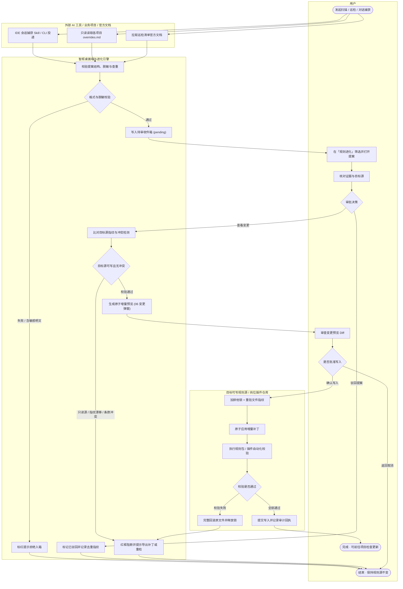
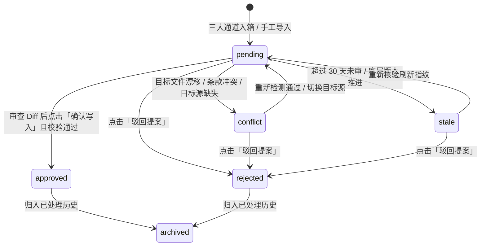

# 智枢 2.0 产品需求文档（PRD）

> **文档状态**：2.0 正式基线 + **2.1「规则自动进化」增量规划**（正式产品名：**智枢**，全称 **智脑 · 智枢**；英文标识：`zhishu` / `ZhiShu`）
> **仓库发布基线**：规则包 / CLI / 岗位插件 `2.0.0`，桌面应用 `2.0.0`（2.1 增量能力标注为 **【2.1 规划目标】**，当前尚未落代码）
> **编写原则**：严格区分 **【现状事实】**（当前源码已实现）与 **【2.1 规划目标】**（待设计与开发），不将未实现的目录或能力描述为现状。架构与生态调研见 [智枢-生态调研与架构设计](智枢-生态调研与架构设计.md)，完整产品结构见 [智枢-产品结构图.xmind](智枢-产品结构图.xmind)。

---

## 1. 背景与现状诊断

### 1.1 当前已建成能力（现状事实）

- **工程级安全底座**：`@zhishu/core` 已实现基于文件证据的技术栈检测、规则包依赖闭包解析、预览差异后再应用、受管文件与受控区块漂移检测、未知文件防覆盖、独占写锁、事务暂存回滚与中断恢复，以及 GitHub Release 的 SHA-256 校验与防压缩炸弹解压。
- **规则资产基础**：`rulepacks/` 维护 20 个规则包、158 份 Markdown（覆盖 `common`、`go`、`java`、`python`、`javascript`、`typescript`、`unity`（含 XR 空间 UI 实现规则）、`pico`、`rule-authoring`、`ui-design`（含 XR 空间界面与跨设备空间布局摆放规范）、`xr-common`、`product-pm`、`3d-art`、`ta-vfx-shader` 及各自 `project-docs/*`）。
- **独立桌面端基线**：桌面版 `1.2.2` 提供「我的项目」「项目规则」「插件与技能」三页，支持多项目登记、共享 `AGENTS.md` 受控区块入口、本机插件/Skill 只读快照导入，以及 Codex 原生插件与 Codex / TraeWork 独立 Skill 的用户环境预览安装。

### 1.2 产品当前不成熟之处（客观诊断）

1. **能力停留在静态多文档层**：现有交付物以静态规则文档为主，缺少面向真实 XR 产研岗位的组合插件（**Plugins**）、可复用任务流程（**Skills**）与外部协作工具连接（**MCP**）。静态规则只能管“红线与标准”，把复杂工作流塞进规则文档会导致上下文膨胀与执行失真。
2. **岗位覆盖过度偏向纯研发编码**：桌面端安装页目前仅提供 5 个语言技术栈单选，未完整覆盖产品经理、UI 设计师（含 XR 空间 UI）、三维设计师（含图生 3D 流程）、技术美术（TA）等 XR 产研关键岗位，也无法支持多岗位混合项目。
3. **企业与个人私有资产链路不完整**：本产品核心价值高度面向**企业及企业内部业务资产**的沉淀、合规治理与分发，但当前缺乏企业私有源订阅、企业必选规范治理与个人私有资产管理链路。
4. **多 AI 工具全局环境尚未拉齐**：项目规则已可通过 `AGENTS.md` + `.agent-rules/` 共享，但各 AI 工具的全局用户环境路径彼此独立（Codex 使用 `~/.agents/skills/` + `~/.codex/config.toml`，Antigravity 使用 `~/.gemini/config/`，TRAE 使用 `~/.trae-cn/skills/`）；需要统一源格式并支持安装时多选 AI 工具一键同步。
5. **桌面信息架构需升级承接 2.0 资产规模**：顶栏 3 Tab 在扩展为「三类来源（企业 / 个人 / 官方）× 四大并行资产树（规则 / 插件 / 技能 / MCP）× 6 大 XR 岗位 × 多 AI 工具」后承载力不足，需升级为左侧 4 模块清晰导航。

---

## 2. 产品定位与边界（2.0 规划目标）

### 2.1 核心定位

> **一款独立于具体 AI IDE 的「企业与个人全岗位 AI 工程资产管理与跨工具分发平台」（产品名：**智枢** / 智脑 · 智枢）。**
> 以**底层规则（Rules）为项目级规范底座**，在用户级并行管理**岗位插件（Plugins）、独立技能（Skills）、独立 MCP**三大资产树；重点承载**企业私有业务资产**与**个人沉淀资产**（兼顾官方通用基线），源格式统一采用 **`.agents` + `SKILL.md` + `AGENTS.md` + `MCP`** 开放标准，安全可控地分发到 **OpenAI Codex、Antigravity、TRAE** 及其他兼容 `AGENTS.md` 的 AI 工具。

### 2.2 核心价值主张

1. **企业业务资产的一等公民支持**：企业可集中维护面向自身业务线（如 XR / Unity 空间计算研发、三维数字内容制作、全栈软件研发等）的专属底层规则、岗位插件与外部协作 MCP，统一分发给团队成员本机的各类 AI 工具。
2. **统一源格式，多 AI 工具一键同步**：项目级通过 `AGENTS.md` + `.agent-rules/` 共用一份规则；用户级以开放标准维护一份资产源，安装时由用户勾选目标 AI 工具（Codex / Antigravity / TRAE / 通用目录），按各自配置路径自动同步。
3. **聚焦 XR 研发产线，6 大核心岗位闭环**：完整覆盖产品经理、UI 设计师、三维设计师、技术美术（TA）、Unity 开发工程师、全栈开发工程师 6 大岗位，并独立预置飞书 MCP 联通团队文档、多维表格、待办与会议纪要。
4. **安全可审查的工程底线**：延续 1.x 核心护城河——预览差异后再应用、冲突与未知文件阻断、独占锁与事务回滚、不自动执行导入源脚本、敏感凭证仅存本机且预览脱敏。

### 2.3 产品边界（明确不做什么）

- **不替代 AI IDE，不做大模型对话外壳**：不内嵌代码编辑器、不代理 LLM 对话计费。
- **不把智枢本身打包进 IDE 插件市场**：AI 工具仅接收经适配器交付的选定资产，智枢本身始终是独立桌面客户端与 CLI。
- **不把企业/个人密钥写进资产包**：MCP 凭证与内网密钥通过本机配置注入，预览时脱敏显示（如 `••••3f9a`），绝不进入 Git 或共享资产包。
- **不混淆项目级与软件用户级作用域**：底层规则安装到具体项目目录；插件、技能与 MCP 安装到所选 AI 工具的本机用户环境（跨项目复用），不做项目级强制绑定插件。

---

## 3. 四大并行资产树与三级来源

### 3.1 并行资产结构

四大资产树职责清晰、彼此并行，不把岗位专属技能重复展示到独立技能列表中：

| 资产树 | 核心职责 | 形态与标准 | 默认作用域 | 当前 2.0 预设范围 |
|---|---|---|---|---|
| **底层规则（Rules）** | 规定企业与项目必须遵守的规范、红线与事实 | 分层 Markdown 规则包（`pack.json` + 入口/专题），落盘至项目 `.agent-rules/` 与 `AGENTS.md` 受控入口 | **项目级** | 已具备 20 个规则包（158 篇），含 XR 产线包 `xr-common`、`product-pm`、`ui-design` XR 空间界面与布局摆放架构、`unity` XR 空间 UI 实现、`3d-art`、`ta-vfx-shader` |
| **插件（Plugins）** | 按岗位打包的一组协同 Skills 与关联规则声明 | 版本化岗位插件包（统一 `.agents` / `plugin.json` 源格式） | **AI 工具用户级** | 预设 **6 大 XR 岗位插件**（共 42 个岗位专属 Skills） |
| **技能（Skills）** | 不归属于特定岗位的独立单点技能 | 开放标准 `SKILL.md` 目录（YAML frontmatter + SOP 正文 + 脚本/模板） | **AI 工具用户级** | **保留独立并行分支，当前不预设下级目录树**；支持通过「导入本地」安装单点 `SKILL.md` |
| **MCP（连接器）** | 独立连接外部软件与协作系统的工具协议 | 标准化 MCP 清单（本机 `stdio` / 远程 HTTP + 脱敏环境变量） | **AI 工具用户级** | **当前唯一预设 `飞书 MCP`**（一次安装、全岗位按需调用）；支持通过「添加 MCP」接入自定义 MCP |

> **优先级与调用约定**：通用基线 < 岗位/领域规则 < 企业必选规范 < 项目本地覆盖（`.agent-rules/overrides.md`）与项目事实。岗位插件中的技能在执行时动态读取当前项目生效的底层规则，不复制规则正文；未安装 MCP 不影响本地技能正常运行。

### 3.2 三级资产来源（企业优先）

| 来源级别 | 定位 | 典型载体 | 信任与治理机制 |
|---|---|---|---|
| **企业源（Enterprise，核心场景）** | 承载企业专属业务规范、XR 产研标准、内部 MCP 与岗位插件 | 私有 Git 仓库（HTTPS/SSH）、内网链接、企业离线归档包 | 支持配置企业必选规则标记；成员订阅后一键同步与差异审查；鉴权凭证仅存本机 |
| **个人源（Personal）** | 个人沉淀的私有规则、自定义技能、MCP 配置与本地导入快照 | 本地目录、个人 Git 仓库、本机导入快照 | 保留来源、许可与 SHA-256 摘要，导入仅只读扫描，绝不执行源脚本 |
| **智枢官方源（Official）** | 智枢开源通用规则基线与开放标准基础资产 | GitHub Release（`tar.gz` + SHA-256 + `sourceCommit`） | 内置只读；自动核验 SHA-256、防压缩炸弹、防版本降级与同版本篡改 |

---

## 4. 6 大 XR 岗位插件与预设 MCP 清单（2.0 规划目标）

### 4.1 6 大岗位插件（对应「插件与技能 → 插件」Tab）

| 序号 | 岗位插件名称 | 预设组合技能（Skills） | 关联底层规则（Rules） | 底座现状 |
|---|---|---|---|---|
| 1 | **产品经理** | `需求调研与竞品分析`、`产品结构图生成`、`业务流程图与泳道图生成`、`PRD 需求文档编写`、`XR 空间界面规划`、`需求自检与 XR 盲区排查`、`版本验收清单生成`、`会议纪要转待办`（8 个） | `product-pm`、`xr-common` | 底层规则与岗位插件源码已完工并通过校验 |
| 2 | **UI 设计师** | `界面需求与状态梳理`、`交互线框与布局方案`、`视觉风格与设计系统搭建`、`XR 空间界面布局设计`、`XR 空间界面规范检查`、`设计稿走查与研发交付`、`界面实现还原度验收`（7 个） | `ui-design`（含 XR 空间 UI 与布局架构）、`project-docs/ui-design` | 底层规则与岗位插件源码已完工并通过校验 |
| 3 | **三维设计师** | `图生 3D 提示词与参考图准备`、`AI 生成模型修复与重拓扑`、`XR 模型与贴图规范体检`、`FBX / glTF 导出校验`、`美术资产入库清单生成`、`Blender 批处理脚本生成`（6 个，适配 Tripo / 混元 3D / Hyper3D 等图生 3D 流程） | `3d-art`、`xr-common` | 底层规则与岗位插件源码已完工并通过校验 |
| 4 | **技术美术（TA）** | `特效性能体检`、`Shader 代码审查与优化`、`渲染管线与材质规范检查`、`Unity 资产导入校验脚本生成`、`真机性能剖析与报告输出`（5 个） | `ta-vfx-shader`、`unity`、`xr-common` | 底层规则与岗位插件源码已完工并通过校验 |
| 5 | **Unity 开发工程师** | `Unity 代码规范审查`、`XR 真机性能排障`、`Unity XR 空间 UI 实现`、`场景与预制体诊断`、`PICO / XR 打包发布前检查`、`单元测试与验证脚本编写`、`Unity 架构与时序图生成`、`Unity 技术文档同步`（8 个） | `unity`（17 专题）、`pico`、`project-docs/unity`、`xr-common` | 规则底座与岗位插件源码已完工并通过校验 |
| 6 | **全栈开发工程师** | `代码审查与风险排查`、`接口契约与前后端联调核对`、`系统架构与时序图生成`、`组件与页面样式走查`、`跨端空间 UI 开发实现`、`数据库与迁移变更检查`、`自动化测试生成`、`技术文档与变更日志同步`（8 个） | `javascript`、`typescript`、`go`、`java`、`python`、`xr-common` 及配套 `project-docs/*` | 规则底座与岗位插件源码已完工并通过校验 |

### 4.2 独立 MCP 清单（对应「插件与技能 → MCP」Tab）

- **当前唯一预设（1 个）**：**`飞书 MCP`**（远程服务）——支持云文档与知识库读写、多维表格记录读写（需求表 / 资产入库表 / 验收表）、待办任务创建与状态更新、会议纪要/妙记读取、群消息与进度同步。
- **后续按需扩展（规划占位，当前不预设）**：Figma MCP、Blender MCP / 图生 3D 工具 MCP、Unity Editor MCP / Android ADB MCP、浏览器调试与数据库只读 MCP；当前已开放「添加 MCP / 导入自定义 MCP」入口。

---

## 5. 桌面端与 CLI 核心功能需求

> 桌面端 UI 严格遵守 [AGENTS.md](../../AGENTS.md) 约束：**不添加段落式介绍、功能解释或重复操作说明**，仅呈现标题、字段、状态、必要错误与可审查变更；所有下拉选择统一使用自定义 `Dropdown` 组件；所有插件、技能与 MCP 统一使用白底专属图标（具备官方品牌的直接采用官方 Logo，如飞书 MCP、Unity）。

### 5.1 左侧 4 模块主导航架构（已定稿）

桌面端 2.0 采用**左侧固定导航栏（216px，4 个一级模块）**：
1. **我的项目**（项目级：`01 · 我的项目` 列表页 + 点击进入 `02 · 项目规则` 页）
2. **插件与技能**（用户级：`插件` 2×3 岗位网格 / `技能` 空态与本地导入 / `MCP` 飞书预设与自定义添加 + 按需滑出右侧安装抽屉）
3. **AI 工具**（按本机 AI 工具盘点环境与已装资产，列表项带白底专属 Logo）
4. **来源管理**（企业源 / 个人源 / 官方源管理 + 添加来源弹窗 + 本地导入列表）

### 5.2 模块功能需求详表

| 模块 | 编号 | 功能项 | 关键行为与验收要点 | 优先级 |
|---|---|---|---|---|
| **M1 我的项目** | F1.1 | 项目列表与状态总览（`01`） | 展示已登记项目名、来源标签、适用 AI 工具（`AGENTS.md` / Codex / Antigravity / TRAE）、路径、已装规则包摘要与状态徽章（正常 / 可更新 / 异常·需处理 / 中断未完成 / 未安装 / 不可用），支持搜索、添加项目与移出列表（移出不删项目文件）。 | P0 |
| | F1.2 | 项目规则工作台（`02`） | 通过顶部自定义下拉框切换「我的项目」中的项目；提供「配置与安装 / 检查更新 / 卸载」3 种模式；支持按岗位与领域多选规则包（通用、XR 通用基准、企业必选、产品与 UI、三维与 TA、Unity 与全栈），自动标识依赖与企业必选锁定项。 | P0 |
| | F1.3 | 证据自动检测推荐 | 未安装项目默认调用 `detectProject()` 展示检测结果徽章（如 `已识别 Unity`）并预选推荐规则包，用户可自由增减跨职能规则包。 | P0 |
| | F1.4 | 统一 `AGENTS.md` 交付与异常恢复 | 支持通用标准（`AGENTS.md`）、OpenAI Codex、Antigravity、TRAE（新版）及其他兼容工具共用一份 `.agent-rules/` 规则；支持检查更新、逐文件 Diff 预览、安全卸载及可视化中断事务恢复。 | P0 |
| **M2 插件与技能** | F2.1 | 三大平行 Tab 与简洁筛选（`03` / `03-B` / `03-C`） | 顶部提供「插件 / 技能 / MCP」下划线 Tab、搜索框、来源自定义下拉框与「导入本地 / 添加 MCP」按钮；**「插件」Tab 去掉冗余场景横滑卡**，直接以状态胶囊（`全部（6）/ 已安装 / 未安装`）+ **2 列 6 大岗位插件网格**呈现；「技能」Tab 当前无预设时展示简洁空态并引导 `+ 导入本地`；「MCP」Tab 展示 `飞书 MCP` 预设行与自定义 MCP 添加槽位。 | P0 |
| | F2.2 | 按需滑出右侧安装抽屉（`03-B`） | 点击卡片或「+ 安装 / 配置」从右侧滑出安装抽屉，展示白底专属 Logo、版本、来源、包含技能清单 / 关联规则，支持多选目标 AI 工具一键同步（Antigravity / OpenAI Codex / TRAE / 通用目录）；对不兼容工具灰显并注明原因，绝不私自删减功能。 | P0 |
| | F2.3 | MCP 专项配置与凭证脱敏 | 安装或配置 MCP（如 `飞书 MCP`）时填写本机配置参数（如 `FEISHU_APP_ID`、`FEISHU_APP_SECRET`），标注 `仅存本机`；在变更预览弹窗中明文展示写入路径与脱敏 JSON（`••••3f9a`）。 | P1 |
| **M3 AI 工具** | F3.1 | 本机工具自动检测（`04`） | 自动探测 OpenAI Codex（`~/.codex · ~/.agents/skills`）、Antigravity（`~/.gemini/config`）、TRAE（`~/.trae-cn/skills`）及通用目录（`~/.agents/skills`），展示可用状态、支持能力与已装项数，支持「重新检查」。 | P0 |
| | F3.2 | 按工具管理已装清单（`04`） | 点击工具卡片切换下方已安装清单；每行以 **白底专属 Logo + 类型徽章（插件 / 技能 / MCP）** 开头，展示名称、版本、来源、校验状态（已识别 / 正常 / 已停用 / 冲突·需处理），支持同源版本切换下拉、MCP 环境变量快捷修改、更新与安全卸载。 | P0 |
| **M4 来源管理** | F4.1 | 三类来源管理与添加弹窗（`05` / `05-B`） | 展示并管理企业源（置顶高亮，含必选规范数与同步时间）、个人源、智枢官方源（内置只读）；点击 `+ 添加来源` 打开弹窗配置名称、级别、接入方式（私有 Git / 内网链接 / 本地目录）、地址与分支、本机脱敏鉴权及企业必选开关，支持测试连接。 | P1 |
| | F4.2 | 本机只读快照导入与导出 | 兼容 1.2.2 导入器：选择本机插件包、独立 `SKILL.md` 或 MCP 目录做只读安全扫描（禁软链接、限体积与文件数）并展示导入卡片，支持「去安装」与导出 TraeWork ZIP。 | P0 |
| **M5 全局弹窗 & CLI** | F5.1 | 变更预览弹窗三态（`06`） | 统一承接规则变更预览（正常 Diff + 保留本地文件）、冲突拦截（精确到文件路径、禁用确认按钮）与 MCP 安装确认（脱敏 JSON 审查）；写入期间锁定界面防误操作，应用前二次校验。 | P0 |
| | F5.2 | CLI 与桌面端能力拉齐 | `zhishu` CLI 同步支持多平台 `--targets`、按包增删与 2.0 来源/资产校验命令（规划：`zhishu source`、`zhishu asset`），消除 `0.1.5` 与桌面端版本割裂。 | P1 |

---

## 6. 分阶段路线图与验收标准

| 里程碑 | 核心目标 | 关键验收条件 |
|---|---|---|
| **M0：产品定义、品牌与 Figma UI 定稿（已完成）** | 完成 2.0 PRD、生态架构设计、XMind 产品结构图、`3-W1` 品牌标识与白底图标集、Figma `01 品牌与组件` + `02 界面设计` 全部核心与辅助画板 | 产品结构、6 大 XR 岗位插件、唯一预设飞书 MCP 与全部 UI 画板经评审定稿 |
| **M1：XR 底层规则库补齐（已完成）** | 在 `rulepacks/` 补建 `xr-common`、`product-pm`、`ui-design` XR 空间界面与布局摆放架构、`unity` XR 空间 UI 实现、`3d-art`（含图生 3D 规范）与 `ta-vfx-shader`，同步更新 manifest 与来源清单 | 20 个规则包（158 份文档）已通过 `npm run check`、`check-rule-docs.sh` 及本仓自举校验，随 `v2.0.0` 发布 |
| **M2：2.0 桌面框架与多岗位规则工作台（已完成）** | 左侧 4 模块 UI 上线；多岗位/多技术栈规则多选组合器接入新规则包；补齐可视化中断恢复、系统默认字体统一与 CLI 多平台参数对齐 | 混合 XR 测试工程可组合安装多岗位规则，Codex / Antigravity / TRAE 规则校验与卸载全通过 |
| **M3：岗位插件 + 技能 + 飞书 MCP 跨工具闭环（已完成）** | 落地 6 大岗位插件与 42 个 Skills（含 4 份跨角色空间 UI 协同 Skills）、独立技能本地导入、飞书 MCP 脱敏配置与「AI 工具」全生命周期管理 | 同一岗位插件与飞书 MCP 在至少 2 个 AI 工具完成预览安装、识别验证与干净卸载 |
| **M4：企业私有源治理与发布** | 接入企业私有 Git / 内网源、企业必选规则治理与团队端到端分发验证 | 独立私有仓库作为企业源完成拉取、差异审查、多工具分发与安全测试 |
| **M5（2.1 规划）：规则自动进化闭环** | 落地左侧第 5 一级模块「规则进化」、三大进化通道（对话捕获 / `overrides.md` 升格 / 官方文档巡检）、ACE 原子增量补丁与全量人工 Diff 审批闸口，并同步发布空间 UI 官方参数校准与官方源 20 包可用性修复 | 三条通道均可生成结构化提案并经人工审查增量 Diff 原子落盘至可写规则源/Skill，自动校验不通过时完整回滚；无静默写入行为 |

---

## 7. 2.1 增量需求：规则自动进化工作台（【2.1 规划目标】）

### 7.1 背景痛点、核心目标与范围边界

#### 背景与真实痛点（来自 2.0 真实使用反馈）
智枢 2.0 已实现静态规则与岗位 Skills 的分发治理，但规则资产自身仍依赖人工回到仓库手工编辑、同步与发版，存在三类高频断层：
1. **实战纠偏流失在聊天记录中**：用户在 Antigravity / Codex / TRAE 中发现 AI 盲区、排障结论或交互规范纠偏，会话结束后无法沉淀，换新项目或换同事后 AI 反复犯同样错误。
2. **多项目重复手写本地覆盖**：同一条团队约定在多个项目的 `.agent-rules/overrides.md` 中被反复复制，难以自动识别共性并升格为共享规范。
3. **外部框架与硬件官方规范滞后**：Apple visionOS HIG、Meta Horizon OS、PICO OS/SDK、Unity 等外部一手文档持续演进，静态规则正文容易悄然过时。

#### 核心目标（2.1）
构建 **「AI 自动完成 90% 发现、查证、查重与增量起草 + 人花 5 秒审阅增量 Diff 做最后 10% 拍板」** 的活规则闭环：将实战经验与外部变化收拢到智枢桌面端独立收件箱，人工批准后原子写回可写规则源或岗位 Skill，并通过既有「项目规则 → 检查更新」分发至全部下游项目。

#### 范围边界（In Scope vs Non-Goals）

| 范围 | 具体内容 | 优先级 |
|---|---|---|
| **本期必做（In Scope）** | 左侧导航栏新增第 5 个一级模块 **「规则进化」**（含侧边栏待审计数徽章） | P0 |
| | **通道 1 · 对话现场「边用边学」捕获**：通过跨工具捕获 Skill 与 CLI `zhishu evolve capture` 将对话中的纠偏/排障/调研结论提炼为结构化提案投递至本机收件箱 | P0 |
| | **通道 2 · 多项目 `overrides.md` 共性升格**：扫描「我的项目」列表中已登记项目的 `.agent-rules/overrides.md`，按主题聚类提炼跨项目（默认 ≥ 2 个项目）重复约定生成升格提案 | P0 |
| | **通道 3 · 外部官方文档巡检**：维护可配置巡检源清单，按需手动触发外部官方文档核验，比对规则正文识别参数滞后或接口变更并生成附出处链接的修订提案 | P0 |
| | **ACE 原子增量补丁与查重防坍塌**：每条提案仅允许 `新增条目 / 修订条目 / 废弃清理` 三类原子增量操作，禁止整篇重写规则文件；提供相似条款查重、文件体量预算提醒与过期陈旧提醒 | P0 |
| | **全量人工 Diff 审批闸口**：所有对规则源 / Skill 的写入必须先经过变更预览弹窗审查增量 Diff 并点击「确认写入」；写入后自动执行规则/插件校验，校验失败自动回滚 | P0 |
| | **只读官方源补丁导出**：目标为只读「智枢官方源」时，明确拦截直接写入并提供「导出补丁」用于本地仓库审阅或提 PR | P1 |
| **明确不做（Non-Goals）** | **绝不做无人工批准的后台静默改写规则正文或 Skill 正文** | 红线 |
| | 不自动修改或删除业务项目中的 `.agent-rules/overrides.md`（扫描阶段严格只读） | 红线 |
| | 不将用户完整对话记录、本机密钥或私有业务源码原文写入共享规则源或上传云端 | 红线 |
| | 2.1 期不自建企业级多租户审批后端服务（企业团队共享审批仍衔接企业私有 Git 源与 PR 流程） | 边界 |

### 7.2 三大进化通道与防坍塌策略规格

| 通道 | 触发方式 | 证据输入源 | 产出路由规则 | 安全与防噪约束 |
|---|---|---|---|---|
| **通道 1：对话捕获** | 用户在 IDE 会话中触发捕获，或通过 CLI `zhishu evolve capture` 提交 | 脱敏后的单次纠偏结论、排障根因、调研证据与来源标注 | 约束“红线/参数/选型标准” → **底层规则**；约束“操作步骤/自检流程” → **岗位技能** | 拒绝写入密钥、绝对本机私密路径与项目专属业务名；同指纹重复投递自动折叠提示 |
| **通道 2：本地覆盖升格** | 在「规则进化」点击「扫描本地覆盖」手动触发 | 「我的项目」已登记且可访问项目的 `.agent-rules/overrides.md` | 按条款语义聚类，≥ 2 个项目命中同主题共性约定 → 归类至对应规则包生成升格提案 | 仅只读扫描，绝不改写原项目 `overrides.md`；自动过滤项目特例（如特定目录/包名/内网域名） |
| **通道 3：官方文档巡检** | 在「规则进化」点击「巡检官方文档」手动触发（巡检清单可配置） | 巡检源登记的官方 URL + 对应规则包正文 | 仅对存在明确版本/参数/API 差异的条目生成修订提案，必填官方文档 URL、核验日期与原文依据摘要 | 联网失败或目标不可达时按源报错并保留其余结果；无实质变更不产生空提案 |

> **防上下文坍塌与防膨胀约束（基于 ACE 与行业实践）**：
> - **原子增量操作**：提案只能声明精确锚点（目标文件 + 所属章节标题 + `add-item` 新增 / `update-item` 修订 / `deprecate-item` 废弃），禁止整篇替换覆盖既有规则正文。
> - **查重与体量预算**：入箱及审阅时比对目标文件现有条款，提示相似重复项；当单份规则文件超过体量预警线（如 > 260 行）或 `SKILL.md` 超过精简预算时，提示优先修订/合并旧条目而非盲目叠加。
> - **过期陈旧衰减**：待审提案挂起超过 30 天未处理，或目标规则源版本已推进时，自动标记为「已陈旧」，审阅时需重新校对目标文件指纹后方可进入变更预览。

### 7.3 跨端业务泳道图

#### 主流程：三通道提案生成 → 审阅 → 人工审批原子落盘

### 7.4 提案生命周期状态机与统计口径

- **统计口径（确保导航徽章、胶囊数字与列表行严格一致）**：
  - 左侧导航栏「规则进化」红/蓝徽章计数 = 当前 `pending` + `conflict` 提案总数（不含 `stale` 以外已归档历史；为 `0` 时隐藏徽章）。
  - 顶部状态胶囊：`待审` = `pending` + `stale`；`有冲突` = `conflict`；`已处理` = `approved` + `rejected` + `archived`。
  - 每次入箱、审阅写入、驳回或重新检测完成后立即刷新徽章与胶囊计数。

### 7.5 桌面端模块规格与交互入口交接覆盖表（零悬空入口）

左侧导航栏在 2.1 升级为 **5 个一级模块**：`我的项目`、`插件与技能`、`AI 工具`、`来源管理`、**`规则进化`**。所有按钮严格遵守单一动词命名红线（禁止拼接动词）：

| 触发入口 / 控件 | 所属区域 | 目标落点 | 正常态与结果反馈 | 异常 / 拦截态反馈 |
|---|---|---|---|---|
| 侧边栏「规则进化」 | 左侧主导航第 5 项 | 主工作区 `07 · 规则进化` 页面 | 高亮激活，显示待审计数徽章 | 收件箱读取损坏时展示红框错误与文件路径 |
| `扫描本地覆盖` 按钮 | `07` 顶部工具栏 & 空态引导 | 原地执行通道 2 扫描 | 执行中锁定按钮 → 成功提示“新增 N 条升格提案”或“未发现跨项目共性覆盖”并刷新列表 | 跳过不可访问项目并在反馈条列出跳过数；全部项目不可用时报错 |
| `巡检官方文档` 按钮 | `07` 顶部工具栏 & 空态引导 | 原地执行通道 3 巡检（进度条 + 可取消） | 显示当前巡检进度 → 产出修订提案或提示“全部巡检源无滞后差异” | 单源网络超时/失败时返回**部分失败明细**，保留其余成功结果并支持重试 |
| `管理巡检源` 按钮 | `07` 顶部工具栏 | 弹窗 `07-C · 巡检源配置弹窗` | 维护外部官方 URL、关联规则包、启停状态，点「保存配置」刷新 | URL 非 HTTPS 或缺少关联规则包时行内标红阻止保存 |
| `导入提案` 按钮 | `07` 顶部工具栏 | 系统文件选择器（`.json`） | 只读解析并执行脱敏/格式校验 → 加入「待审」并弹出成功提示 | 非法结构、超体积或含明文密钥时报错拦截，不入箱 |
| 状态胶囊 / 通道下拉 / 类型下拉 / 搜索框 | `07` 筛选条 | 原地过滤提案列表 | 实时联动更新卡片列表与命中数 | 无匹配结果展示简洁空态与「重置筛选」 |
| 提案行「查看审阅」或点击卡片 | `07` 提案列表 | 右侧滑出 `07-B · 提案审阅抽屉` | 展示证据、查重报告、可写目标源自定义下拉与增量补丁编辑区 | 提案已被外部移动/删除时报错并刷新列表 |
| 提案行「驳回」/ 抽屉「驳回提案」 | `07` 列表 / `07-B` 抽屉 | 轻量原因确认 → 移入「已处理」 | 记录驳回原因与防重复指纹，递减待审计数并展示成功提示 | 无（本地原子更新失败时保留原状态并报错） |
| 抽屉「重新检测」 | `07-B` 冲突/陈旧提案态 | 原地刷新目标源指纹与查重 | 冲突消除后恢复为「待审」并解锁「查看变更」 | 冲突仍存在时更新具体冲突行与原因 |
| 抽屉「导出补丁」 | `07-B` 抽屉底部（只读官方源必显） | 系统保存弹窗（`.patch` / `.md`） | 写出标准增量补丁文件，提示导出路径 | 目标文件已存在拒绝静默覆盖并提示 |
| 抽屉「查看变更」 | `07-B` 抽屉底部主操作 | 全局 `06 · 变更预览弹窗`（增量 Diff 态） | 展示完整前后文件 Diff、自动校验项与「确认写入」按钮 | 目标源只读、存在冲突或指纹漂移时红框阻断且禁用「确认写入」 |
| 弹窗「确认写入」 | `06` 变更预览弹窗 | 原子写入目标规则源/Skill + 自动校验 | 执行中防连点锁定 → 写入并校验通过 → 更新状态为「已写入」+ 成功提示（附「前往我的项目检查更新」跳转） | 写入失败或 `validate-rulepacks` / `validate-plugins` 校验失败时**完整回滚原文件**并红框报错 |

### 7.6 2.1 可观测验收标准（Acceptance Criteria）

| 编号 | 所属场景 | 路径类型 | 前置条件 | 触发动作 | 可观测预期结果 |
|---|---|---|---|---|---|
| `AC-EV-01` | 通道 1 对话捕获入箱 | 正向 | 本机已安装智枢，在 IDE 或 CLI 执行 `zhishu evolve capture` 投递合法规范提案 | 打开桌面端「规则进化」页 | 侧边栏待审徽章加 1，「待审」列表可见该提案，来源通道标「对话捕获」，无敏感明文泄露 |
| `AC-EV-02` | 通道 2 `overrides.md` 升格 | 正向 | 「我的项目」已登记 ≥ 2 个项目，且两份 `.agent-rules/overrides.md` 包含同主题约定 | 点击「扫描本地覆盖」 | 生成 1 条「本地覆盖升格」提案并列出命中项目列表；核对原项目两份 `overrides.md` 字节哈希完全未变 |
| `AC-EV-03` | 通道 3 官方文档巡检 | 正向 / 部分失败 | 巡检清单配置 1 个有效官方源与 1 个故意不可达地址 | 点击「巡检官方文档」 | 有效源正常比对并给出结果或提案；不可达源在部分失败提示中明确列出原因，不中断整体流程 |
| `AC-EV-04` | 人工审批原子写入 | 正向 | 存在 1 条无冲突「待审」规则提案，已选择本地可写规则源 | 打开审阅抽屉 → 点击「查看变更」→ 核对 Diff 后点击「确认写入」 | 目标规则文件仅应用对应增量块（其余段落字节不变）；规则包清单与校验自动通过；提案状态变为「已写入」 |
| `AC-EV-05` | 严禁静默写入红线 | 负向拦截 | 任意通道新生成提案或用户仅打开审阅抽屉/变更预览后点击「返回」 | 未点击「确认写入」退出 | 目标规则源与 `plugins/` 目录下所有文件修改时间与 SHA-256 均保持 100% 不变 |
| `AC-EV-06` | 指纹漂移与冲突阻断 | 负向拦截 | 提案生成后人工修改目标规则文件对应段落，或在目标源选择内置只读「智枢官方源」 | 点击「查看变更」 | 预览弹窗红框展示具体冲突原因或只读提示，「确认写入」按钮保持禁用；仅允许「重新检测」「导出补丁」或「驳回提案」 |
| `AC-EV-07` | 自动校验失败回滚 | 负向拦截 | 构造包含失效 Markdown 相对链接或非法 YAML frontmatter 的异常补丁提案 | 点击「确认写入」 | 写入后自动触发校验拦截失败，引擎完整回滚目标文件至写入前字节状态并释放锁，界面红框报错 |
| `AC-EV-08` | 敏感信息脱敏阻断 | 负向拦截 | 尝试通过 CLI 或「导入提案」投递包含明文 Token / AppSecret 的提案 | 提交投递 / 导入 | 入箱校验直接拦截或强制脱敏，绝不向 `proposals/` 或规则源写入明文凭据 |
