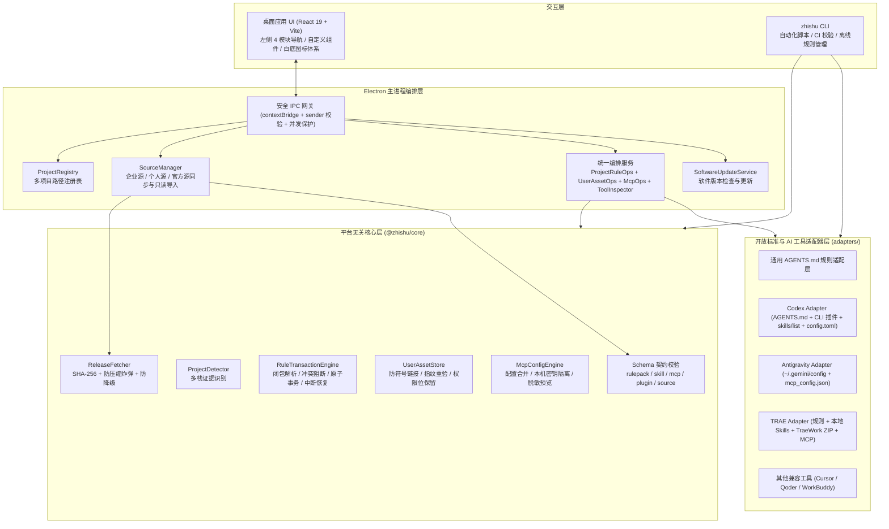
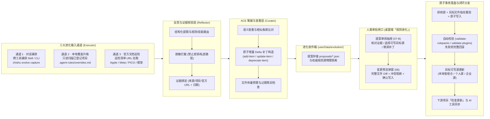
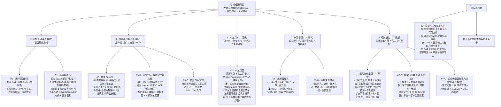
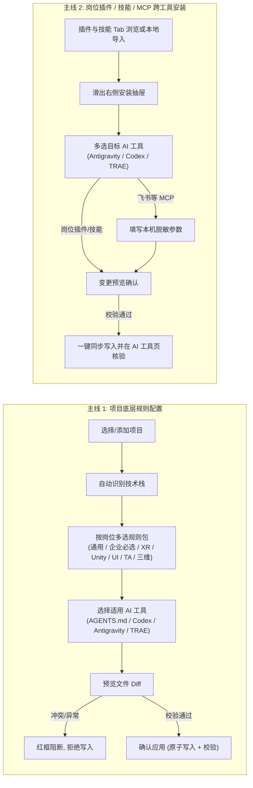

# 智枢 2.0 生态调研与架构设计

> **文档状态**：2.0 正式定稿基线 + **2.1「规则自动进化」增量调研与架构规划**（2.0 现状：XR 产研 6 大岗位插件、四大并行资产树、唯一预设飞书 MCP、左侧 4 模块导航；2.1 规划：左侧扩展第 5 模块「规则进化」、三通道捕获/升格/巡检与全量人工 Diff 审批闸口）
> **证据声明**：行业机制整理自各产品 2025–2026 公开文档、学术论文与本仓库实际配置（规则自进化生态调研核验日期：`2026-11-25`）；未经本机实测验收的 AI 工具适配路径及 2.1 规划能力均明确标注，不将规划或文档机制等同于已验证实现。

---

## 一、主流 AI 编程工具与开放标准生态调研

### 1.1 生态核心收敛：开放标准 vs 工具目录碎片化

2025–2026 年，主流 AI 编程工具已高度收敛到四类核心概念——**底层规则（Rules）、岗位插件（Plugins）、独立技能（Skills）、外部连接（MCP）**，并形成三条跨工具开放标准：
- **项目规则标准**：项目根目录 `AGENTS.md` 与 `.agent-rules/` 已成为跨工具共享项目规范的稳定载体，可被 Codex、Antigravity、TRAE、Cursor、Qoder、WorkBuddy 等工具共同读取。
- **技能标准**：`SKILL.md`（YAML frontmatter + Markdown 流程 + 可选脚本/模板，采用「发现 → 激活 → 执行」渐进式披露）成为跨工具技能事实标准。
- **外部工具标准**：MCP（Model Context Protocol，支持本机 `stdio` 与远程 Streamable HTTP）成为 AI 连接飞书文档、多维表格、引擎与企业系统的统一协议。

尽管开放标准正在收敛，但**各 AI 工具的全局用户级目录仍然彼此隔离**（Codex 读 `~/.agents/skills/` 与 `~/.codex/config.toml`，Antigravity 读 `~/.gemini/config/`，TRAE 读 `~/.trae-cn/skills/`，工作区 `.agents/` 仅作用于单项目而非全局）——这正是智枢采用「**统一 `.agents` + `SKILL.md` 源格式 + 安装时多选 AI 工具一键同步**」的核心架构依据。

### 1.2 首期重点目标 AI 工具与开放标准对比

| 目标工具 / 标准 | 项目规则（Rules） | 全局技能（Skills） | MCP 配置与管理 | 插件 / 组合交付 | 智枢交付策略 |
|---|---|---|---|---|---|
| **通用标准（`AGENTS.md` / `~/.agents/skills`）** | 项目根 `AGENTS.md` + `.agent-rules/` | `~/.agents/skills/<name>/SKILL.md` | 标准 JSON `mcpServers` 清单 | 统一 `.agents` / `plugin.json` 源格式 | 作为智枢内部统一资产源格式，兼顾兼容工具共享 |
| **OpenAI Codex** | 项目根 `AGENTS.md`（已实测验收） | `~/.agents/skills/<name>/SKILL.md`（支持 `codex app-server` 的 `skills/list` 只读识别） | `~/.codex/config.toml` / MCP 声明 | 原生插件 `plugin.json`（兼容 `.codex-plugin/plugin.json`），通过 `codex plugin` 个人市场安装 | 1.2.2 已验证规则、Skill 与原生插件链路；2.0 补齐 MCP 脱敏写入 |
| **Antigravity（Google AGY）** | 项目根 `AGENTS.md` / `.agents/rules/*.md` | 全局 `~/.gemini/config/` 及工作区 `.agents/skills/<name>/SKILL.md` | `~/.gemini/config/mcp_config.json`（支持 stdio / 远程 HTTP） | `~/.gemini/config/plugins/<name>/`（打包 Skills、Rules、MCP、Hooks） | 2.0 重点适配：全局资产同步写入 `~/.gemini/config/` |
| **TRAE（融合端 / TraeWork）** | 项目根 `AGENTS.md` + `.trae/rules/` | `~/.trae-cn/skills/<name>/SKILL.md` 与 ZIP 导入（实验支持） | TRAE 本机 MCP 配置 | 场景插件（含 Skill 与 MCP）；新融合端路径需实机核对 | 保留 TraeWork 本地 Skill 与 ZIP 导出，跟进新 TRAE 实测验收 |
| **其他兼容工具（Cursor / Qoder / WorkBuddy）** | 共享项目根 `AGENTS.md` | 逐步向 `SKILL.md` 收敛 | 均支持标准 MCP | 各自插件机制 | 项目级共用 `AGENTS.md` 受控入口，不修改其原生规则文件 |

### 1.3 XR 软件研发产线 6 大岗位协同工作流

面向 XR 软件研发真实产线，底层规则、岗位插件与外部 MCP 解耦并行：规则在项目内沉淀硬标准，岗位插件打包可执行 Skills，飞书 MCP 作为唯一首期预设工具在用户级一次安装、全岗位按需调用：

| 岗位插件 | 真实产线痛点 | 底层规则底座（项目级） | 岗位组合 Skills（用户级） | 飞书 MCP 协同方式（可选） |
|---|---|---|---|---|
| **产品经理** | XR 空间交互盲区易遗漏、PRD 与验收口径割裂、会后待办靠手工整理 | `product-pm`、`xr-common` | 需求调研与竞品分析、产品结构图生成、业务流程图与泳道图生成、PRD 需求文档编写、需求自检与 XR 盲区排查、版本验收清单生成、会议纪要转待办 | 读取飞书纪要/妙记、写入 PRD 云文档与多维表格待办 |
| **UI 设计师** | 2D 与 XR 空间界面视距/字号/射线热区规范容易混淆、走查与研发还原度难对齐 | `ui-design`（含 XR 空间 UI）、`project-docs/ui-design` | 界面需求与状态梳理、交互线框与布局方案、视觉风格与设计系统搭建、XR 空间界面规范检查、设计稿走查与研发交付、界面实现还原度验收 | 同步设计文档、交付清单与走查问题单至飞书 |
| **三维设计师** | 引入 Tripo / 混元 3D / Hyper3D 等图生 3D 工具后，AI 粗模常出现三角面混乱、非流形、UV 错乱与一体机超预算 | `3d-art`、`xr-common` | 图生 3D 提示词与参考图准备、AI 生成模型修复与重拓扑、XR 模型与贴图规范体检、FBX / glTF 导出校验、美术资产入库清单生成、Blender 批处理脚本生成 | 将美术资产入库清单与质检结果同步到飞书多维表格 |
| **技术美术（TA）** | XR 一体机（如 PICO）特效粒子 Overdraw、Shader 变体爆炸与 DrawCall 超标极易导致掉帧眩晕 | `ta-vfx-shader`、`unity`、`xr-common` | 特效性能体检、Shader 代码审查与优化、渲染管线与材质规范检查、Unity 资产导入校验脚本生成、真机性能剖析与报告输出 | 归档性能剖析报告、推送性能红线预警任务 |
| **Unity 开发工程师** | 场景与预制体隐性引用错误、XR 真机性能排障与发包前漏项频发 | `unity`（16 专题）、`pico`、`project-docs/unity`、`xr-common` | Unity 代码规范审查、XR 真机性能排障、场景与预制体诊断、PICO / XR 打包发布前检查、单元测试与验证脚本编写、Unity 架构与时序图生成、Unity 技术文档同步 | 同步发包检查记录与技术文档到飞书知识库 |
| **全栈开发工程师** | 前后端接口契约漂移、页面样式走查与数据库迁移风险难统一把关 | `js` / `ts` / `go` / `java` / `python` + 配套 `project-docs/*` | 代码审查与风险排查、接口契约与前后端联调核对、系统架构与时序图生成、组件与页面样式走查、数据库与迁移变更检查、自动化测试生成、技术文档与变更日志同步 | 同步接口文档、变更日志与研发待办 |

### 1.4 规则与上下文自进化行业调研（核验日期：`2026-11-25`，【2.1 规划依据】）

2025–2026 年，头部 AI 编程产品与研究界已明确指出：**纯静态规则文件（`AGENTS.md` / `CLAUDE.md` / `.cursorrules`）会随着业务迭代与外部 SDK 升级快速陈旧漂移**，行业正加速收敛为 **「结构化自进化提案 + 人工审批闸口（Human-in-the-Loop）」** 架构：

| 行业标杆 / 研究来源 | 一手公开机制摘要（核验日期 `2026-11-25`） | 对智枢 2.1 的架构借鉴 |
|---|---|---|
| **GitHub Copilot Memory & Dreaming** | 后台分析历史会话、PR 评审与代码变更，自动起草对 `AGENTS.md` / `CLAUDE.md` 的更新提案并经由 PR 交由人工审批；长期未强化的记忆自动衰减过期 | **提案审批闸口（禁止静默覆盖）+ 陈旧衰减提醒（30 天未审标陈旧）** |
| **Anthropic Claude Code（Auto Memory）** | 严格区分「团队权威规范 `CLAUDE.md`」与「会话捕获草稿 `MEMORY.md`」，对索引体积设定硬上限并按专题懒加载防上下文膨胀 | **收件箱提案草稿层与权威规则源彻底物理隔离 + 规则文件体量预算预警** |
| **Cognition Devin（Knowledge）& Cursor** | 知识条目按触发域精准按需加载，并以人工审核 / PR 闸口作为最终写入控制面 | **按目标作用域（底层规则 vs 岗位 Skill）与可写来源分级路由 + 人工终审** |
| **ACE（Agentic Context Engineering，Stanford / UC Berkeley）** | 实证揭示全篇重写规则的两大失效模式——**简短偏置**（越总结越丢失关键边界参数）与**上下文坍塌**（反复整篇改写洗掉既有规范）；提出 **执行者（Executor）→ 反思者（Reflector）→ 策展人（Curator）** 三角色解耦，仅输出**原子增量补丁（Delta Patch）** | **严禁整篇重写规则文件，强制原子增量补丁（`add-item` / `update-item` / `deprecate-item`）+ 查重去噪 + 事务回滚** |

> **智枢 2.1 的差异化定位**：上述大厂方案大多绑定单一 IDE 或单一云端托管平台；智枢依托「独立于 IDE 的本地核心引擎 + 多 AI 工具分发 + 企业/个人/官方三级来源」，可把任意 AI 工具中产生的经验、跨项目 `overrides.md` 共性与外部官方文档变更汇聚到**同一个离线可控的人工审批工作台**，审定后一次同步至全部下游项目与多款 AI 工具。

---

## 二、产品核心架构图

### 2.1 三级来源 × 四大并行资产树 × 多 AI 工具分发全景图

```mermaid
flowchart LR
    subgraph Sources["三级资产来源 (企业优先)"]
        S_Ent["企业源 Enterprise\n私有 Git / 内网链接 / 离线包\n支持企业必选规范标记"]
        S_Per["个人源 Personal\n本地目录 / 个人 Git / 本地导入快照"]
        S_Off["智枢官方源 Official\nGitHub Release + SHA-256"]
    end

    subgraph Assets["四大并行资产树"]
        direction TB
        A1["底层规则 Rules (项目级)\n唯一权威正文 / rulepacks/"]
        A2["岗位插件 Plugins (用户级)\n6 大 XR 岗位 × 42 个组合 Skills"]
        A3["独立技能 Skills (用户级)\n独立单点 SKILL.md\n(当前不预设下级树, 支持本地导入)"]
        A4["独立 MCP (用户级)\n当前唯一预设: 飞书 MCP\n(支持自定义添加其他 MCP)"]
        A2 -.动态读取项目生效规则.-> A1
        A3 -.动态读取项目生效规则.-> A1
    end

    subgraph Engine["智枢安全事务引擎 (桌面端 + CLI)"]
        E1["依赖解析与冲突检测"]
        E2["差异预览 Preview (凭证脱敏)"]
        E3["独占锁 + 原子事务写入 + 崩溃回滚"]
        E1 --> E2 --> E3
    end

    subgraph Targets["跨 AI 工具交付"]
        subgraph ProjScope["项目级作用域 (业务工程内)"]
            P_Std["AGENTS.md + .agent-rules/ + overrides.md\n所有 AI 工具共用一份项目规则"]
        end
        subgraph UserScope["软件用户级作用域 (多选一键同步)"]
            U_Codex["OpenAI Codex\n~/.agents/skills + ~/.codex/config.toml"]
            U_Agy["Antigravity\n~/.gemini/config/ (skills/plugins/mcp_config.json)"]
            U_Trae["TRAE\n~/.trae-cn/skills + TRAE MCP 配置"]
            U_Std["通用目录\n~/.agents/skills"]
        end
    end

    Sources --> Assets
    Assets --> Engine
    E3 --> ProjScope
    E3 --> UserScope
    UserScope -.执行任务时读取.-> ProjScope
```

### 2.2 智枢软件技术架构图

### 2.3 2.1 增量架构：三通道规则自动进化与人类审批闸口（【2.1 规划设计】）

- **核心模块增量落点（规划，待 2.1 工程阶段实现）**：
  - `@zhishu/core`：新增进化契约与原子补丁引擎（`evolution.ts`：提案校验、脱敏过滤、`overrides.md` 聚类分析、章节级原子增量合并、指纹重验与回滚）及对应数据契约文件（规划新增 `evolution.schema.json`）。
  - `packages/cli`：扩展 `zhishu evolve capture / list / scan-overrides / watch / apply` 子命令，打通 IDE 终端与自动化脚本。
  - `packages/desktop-app`：主进程新增 `EvolutionOperations` 服务与 `evolution:*` 受控 IPC 通道；渲染进程在左侧导航新增第 5 个一级模块 **「规则进化」**，复用全局 `PreviewDialog` 完成最终 Diff 审批。
  - `plugins/`：规划在后续 2.1 阶段补齐面向跨工具会话捕获的进化捕获 Skill（与现有 2.0 正式资产分开统计，未落代码前不计入 2.0 现状计数）。

---

## 三、桌面应用信息架构图（与 Figma / XMind 1:1 对齐）

### 3.1 站点结构（2.0 现状 4 模块 → 2.1 规划扩展第 5 模块「规则进化」）

### 3.2 核心用户主线流程

---

## 四、Figma UI 设计交付契约（已定稿）

视觉风格已定型为 **Light Precision（清晰精密浅色工具风）**，主品牌标识定稿为 **`3-W1` 光刃星枢（亮白瓷底 · 宝石钴蓝光刃）**；所有插件、技能与 MCP 图标采用统一白底圆角卡片容器规范。Figma 设计稿精简为 2 个生产页面：

1. **Page `01 品牌与组件`（3 个等高 `Section` 分区）**：
   - `01 · 品牌标识规范`：`3-W1` 桌面图标、纯图形徽标、16–96px 清晰度阶梯、浅/深横版组合（`智枢 / ZhiShu`）与品牌色板；
   - `02 · 设计基础与图标规范`：39 项语义变量（Color / Spacing / Radius Tokens）、`Noto Sans SC + JetBrains Mono` 字体层级，以及飞书官方 Logo、Unity 立方体标识、其余 5 大岗位插件与通用技能的白底专属矢量图标组件；
   - `03 · 核心组件库`：`Button`、`StatusBadge`、`SidebarNavItem`、自定义 `Dropdown`（均已暴露可覆写 `Text Property`，禁止系统原生下拉框）。
2. **Page `02 界面设计`（7 个模块 `Section`、20 个 `1280×771` 完整画板，左侧导航均已扩展第 5 入口「规则进化」）**：
   - `01 · 我的项目`：`01 · 我的项目`（多项目列表与状态标签）；
   - `02 · 项目规则`：`02 · 项目规则`（规则来源切换、规则包多选与 6 平台适用 AI 工具）、`02-B · 检查更新`（差异摘要与可调整配置）、`02-C · 卸载规则`（受管移除清单与本地零误删保护）、`02-D · 异常处理与中断恢复`（文件漂移与 `.agent-rules.transaction-*` 事务恢复）；
   - `03 · 插件与技能`：`03 · 插件与技能`（6 大岗位插件 2×3 网格，共 43 Skills）、`03-B · MCP 列表与安装抽屉`（飞书 `STDIO` 官方预设 + 单选目标工具抽屉）、`03-C · 技能 Tab 空态`、`03-D · 岗位插件安装抽屉与技能预览`、`03-E · 导入本地与添加自定义 MCP 弹窗`；
   - `04 · AI 工具与关键状态`：`04 · AI 工具`（4 工具探测卡片 + 条件式旧版接管提示条 + 紧凑横排已安装清单按需显隐更新/版本切换）、`04-B · 环境变量弹窗、接管预览弹窗与空态`（修改 MCP 环境变量弹窗、接管旧版预览弹窗、`01` 异常中断态、`01`/`04` 空态与 `03` 技能有数据态）；
   - `05 · 来源管理`：`05 · 来源管理`（企业 / 个人 / 官方三类来源、同步/测试连接/移除 + 本地导入列表）、`05-B · 添加来源弹窗`（来源标识 ID、名称、级别、接入方式、本机脱敏鉴权与企业必选规则包）；
   - `06 · 变更预览与执行反馈`：`06 · 变更预览弹窗`（变更预览 / 冲突拦截 / MCP `STDIO` 安装确认三态）、`06-B · 操作执行与多工具结果反馈态`（逐步确认、写入锁定、全成功、部分失败与漂移回滚）；
   - `07 · 规则进化`（**【2.1 增量 UI 已完成 Figma 设计审计与端到端源码落地，真机桌面交互验收待执行】**）：
     - `07 · 规则进化`（主收件箱：顶部工具栏、状态胶囊、通道/类型筛选与三通道提案卡片列表）；
     - `07-B · 提案审阅抽屉`（右侧滑出抽屉：来源与证据、查重与体量预算、可写目标源 `Dropdown`、原子增量补丁编辑与 `驳回提案 / 导出补丁 / 查看变更`）；
     - `07-C · 变更 Diff 审批与结果反馈`（原子增量 Diff 确认写入弹窗、冲突/只读源拦截态与写入成功/校验回滚/驳回顾闭环反馈）；
     - `07-D · 巡检源配置与关键态`（官方文档巡检源管理弹窗、巡检进度与部分失败反馈态、收件箱空态与 >30 天过期陈旧提案态）。
