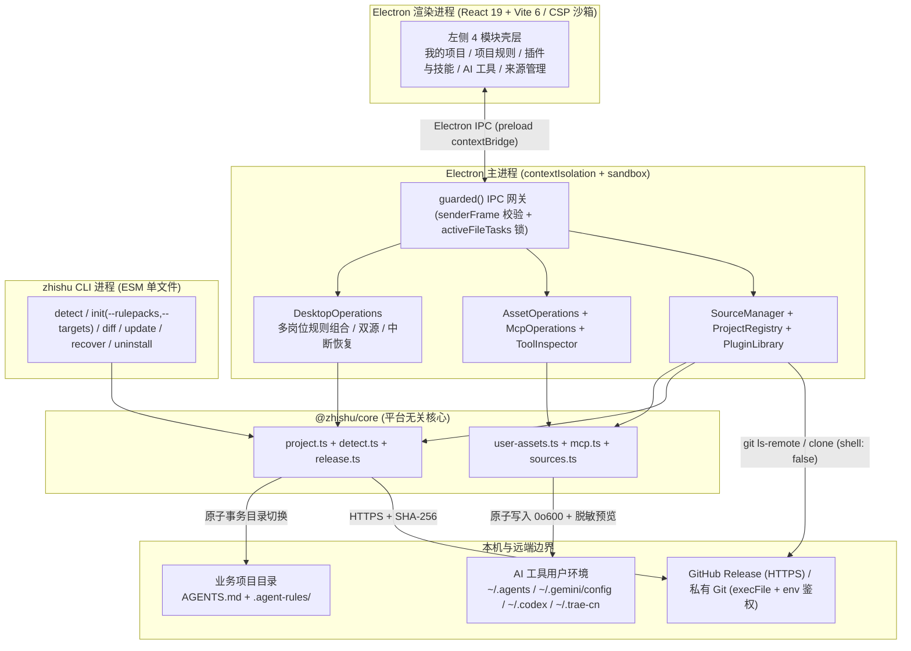
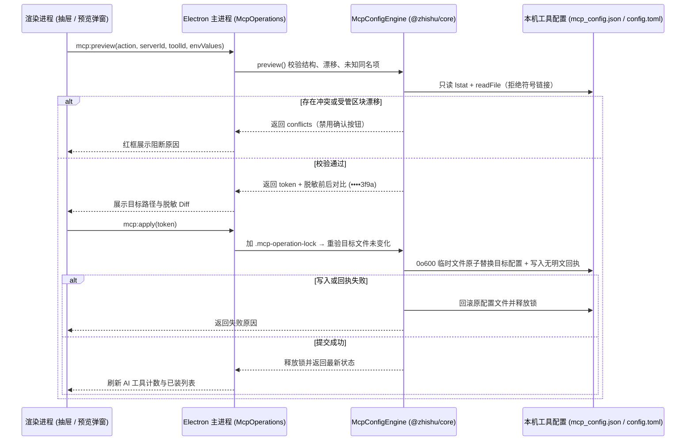

# 01 - 智枢技术总览

本文记录 **智枢（ZhiShu）** `2.0.0` 双轨发布基线（规则包 / Core / CLI / 岗位插件 `v2.0.0`、桌面端 `desktop-v2.0.0`；源码已完成 2.0 核心阶段 Stage 1–3 底座、左侧 4 模块桌面壳层、20 规则包 / 158 份规范含跨设备 XR 空间 UI 体系，并在 `plugins/` 落地 6 大官方岗位插件、共 42 个 Skills）的技术架构、运行单元、核心链路、关键符号、契约与本地验证方式。`workflows/` 预留目录与尚未完成的跨客户端实测验收仍属规划/待验收范围，见 [智枢-产品需求文档](../产品文档/智枢-产品需求文档.md)。

---

## 一、运行时、工具链与工作区边界

- **运行时与模块体系**：Node.js `>= 22`，纯 ESM（`"type": "module"`），由根 [package.json](../../package.json) 通过 npm workspaces 管理 `packages/*` 与 `adapters/codex`。
- **语言与构建**：TypeScript `5.9`（根配置 [tsconfig.base.json](../../tsconfig.base.json) 开启 `strict` 与 `noUncheckedIndexedAccess`）；`@zhishu/core` 与 `@zhishu/adapter-codex` 使用 `tsc` 构建，CLI 与桌面主进程/服务模块使用 `esbuild` 打包，桌面渲染进程使用 `Electron 44 + React 19 + Vite 6` 与 Light Precision CSS 变量体系。
- **测试与静态检查**：统一使用 Node 原生 `node:test` + `node:assert/strict` 与 `tsc --noEmit`；仓库未引入 ESLint、Prettier、Jest、Vitest 或 Tailwind（详见 [.agent-rules/overrides.md](../../.agent-rules/overrides.md)）。
- **两类物理作用域边界**：
  1. **项目级规则作用域**：落盘至目标业务项目的 `agent-rules.yaml`、`.agent-rules.lock.json`、`.agent-rules/`（受管规则副本 + 保留本地 `.agent-rules/overrides.md`）与根目录 `AGENTS.md` 受控区块。
  2. **软件用户级资产作用域**：落盘至所选 AI 工具的本机用户环境（`~/.agents/skills/`、`~/.gemini/config/{skills,plugins,mcp_config.json}`、`~/.codex/config.toml` 受控 MCP 区块、`~/.trae-cn/skills/`、Codex 个人市场缓存），回执与来源注册表保存在应用 `userData/`（`ide-assets/`、`mcp-assets/`、`sources/`），不触碰业务项目。

---

## 二、工作区模块与系统架构



| 工作区 / 目录 | 包名与源码版本 | 职责边界 |
|---|---|---|
| `packages/core` | `@zhishu/core` (`2.0.0`) | 平台无关核心：技术栈检测、20 规则包清单扫描与依赖闭包事务引擎、GitHub Release 校验下载、用户环境资产通用存储（`user-assets.ts`）、MCP 脱敏配置事务引擎（`mcp.ts`）与三级来源治理契约（`sources.ts`） |
| `packages/cli` | `zhishu` (`2.0.0`) | 单文件 ESM CLI（bin: `zhishu`），支持 `init --rulepacks` 与 6 平台 `--targets`、`detect`、`check`、`diff`、`update`、`recover`、`uninstall`、`validate` |
| `packages/desktop-app` | `zhishu-desktop` (`2.0.0`) | Electron 桌面客户端，提供左侧 4 模块导航（我的项目 + 项目规则、插件与技能、AI 工具、来源管理），含 Light Precision 令牌、系统默认无衬线字体体系、集中术语词典、白底图标集、多岗位规则组合器、右侧安装抽屉、MCP 脱敏预览与三级来源管理 |
| `adapters/codex` | `@zhishu/adapter-codex` (`2.0.0`) | 渲染共享 `AGENTS.md` 受控区块（覆盖 `codex` / `antigravity` / `trae` / `qoder` / `cursor` / `workbuddy` 及 XR/产研任务路由）；`user-assets.ts` 提供 Codex CLI 探测、`skills/list` 只读发现、原生插件宿主与 `config.toml` MCP 路径 |
| `adapters/antigravity` | `2.0.0` | Antigravity 用户环境目录适配（`~/.gemini/config/{skills,plugins,mcp_config.json}`） |
| `adapters/traework` | — | TraeWork 本机用户技能目录与 `product-design@0.1.56` 适配封装（实验支持） |
| `adapters/{cursor,qoder,workbuddy}` | `2.0.0` | 平台能力声明（`adapter.json`）与参考模板；共用 `AGENTS.md`，真实客户端加载待验收 |
| `rulepacks/` | `2.0.0`（20 包 / 158 篇） | 唯一权威规则正文来源，含 80% 跨设备 XR 空间 UI 布局规范 + Vision Pro/Meta/PICO 差异矩阵及 Unity XR 空间 UI 实现规范 |
| `plugins/` | `2.0.0`（6 插件 / 42 Skills） | 官方内置 6 大 XR/全栈岗位插件（产品经理、UI、三维、TA、Unity、全栈，含 4 份跨角色空间 UI Skills 与确定性校验脚本），采用统一 `plugin.json` + `skills/*/SKILL.md` 格式，执行时动态引用项目 `.agent-rules/`；桌面端以官方预设加载，打包随 `extraResources` 分发 |
| `schemas/` | — | 7 套 JSON Schema：`adapter`、`asset`、`mcp`、`project-config`、`project-lock`、`rulepack`、`source` |
| `scripts/` | — | 规则清单与来源台账生成、规则结构/链接校验、岗位插件校验（`validate-plugins.mjs`）、跨文件一致性总门禁（`validate-consistency.mjs`）、发布版本核对及端到端测试 |

---

## 三、启动与进程边界

### 1. CLI 进程（`packages/cli`）
- 入口：[packages/cli/src/index.ts](../../packages/cli/src/index.ts)（构建产物 `packages/cli/dist/index.js`）。
- 支持子命令：`detect`、`init`（支持 `--source-workspace`、`--targets`、`--rulepacks`）、`check`、`diff`、`update` / `generate`（加 `--apply` 才写入）、`uninstall`（`--details` / `--apply`）、`recover`（`--apply`）、`validate`、`version`、`help`。
- 关键退出码约定：`0` 正常/最新；`1` 参数错误、校验失败或运行时异常；`2` 存在冲突、漂移或未完成事务阻断；`3` `check` 发现可用更新。

### 2. 桌面应用（`packages/desktop-app`）
- **主进程**（[electron/main.ts](../../packages/desktop-app/electron/main.ts)）：
  - 启动时获取单实例锁（`app.requestSingleInstanceLock()`）；非打包开发态支持 `ZHISHU_DEV_PROFILE=<绝对路径>` 隔离 `userData`、`userHome` 与 `codexHome`。
  - 窗口启用 `contextIsolation: true`、`nodeIntegration: false`、`sandbox: true`，禁用 `will-navigate` 与新窗口打开。
  - `guarded()` 统一校验 `event.sender === window.webContents` 且 `event.senderFrame === window.webContents.mainFrame`，对所有 IPC 入参执行运行时类型校验；文件与同步通道（`rules:*` / `plugins:*` / `assets:*` / `mcp:*` / `sources:*` / `project:recover`）执行期间递增 `activeFileTasks`，阻止软件重启更新打断写入。
- **Preload 桥接**（[electron/preload.ts](../../packages/desktop-app/electron/preload.ts)）：仅依赖 `contextBridge` 与 `ipcRenderer`，向渲染进程暴露最小 `window.zhishu` API 集合。
- **渲染进程**（[index.html](../../packages/desktop-app/index.html)、[src/App.tsx](../../packages/desktop-app/src/App.tsx)）：严格 CSP（`default-src 'self'; script-src 'self'; connect-src 'none'`），所有 UI 文案集中在 [src/copy.ts](../../packages/desktop-app/src/copy.ts)，禁止系统原生下拉框。

---

## 四、核心链路与关键符号

### 1. 项目规则生命周期（`@zhishu/core` + `DesktopOperations`）
1. **检测与组合推荐**：`detectProject(root)`（[detect.ts](../../packages/core/src/detect.ts)）按项目文件标记识别技术栈；`recommendRulepacksForDetection()` 与 `listAvailableRulePacks()`（[project.ts](../../packages/core/src/project.ts)）提供推荐规则包与源内可用清单；企业源必选规则包由 `collectEnterpriseRequiredRulepacks()`（[sources.ts](../../packages/core/src/sources.ts)）在工作台锁定。
2. **双源预览与事务写入**：[electron/operations.ts](../../packages/desktop-app/electron/operations.ts) 的 `DesktopOperations` 同时支持 **GitHub Release 源**（SHA-256 + 防降级 + 防压缩炸弹）与 **本地目录 / 已同步 Git 检出源（`workspace`）**，支持首次多岗位安装、已装项目规则包与平台热调整、逐文件 Diff 预览、独占写锁、原子切换以及 `recover()` 可视化中断事务恢复。

### 2. 用户环境资产与 MCP 脱敏配置链路（`AssetOperations` + `McpConfigEngine` + `ToolInspector`）



- **用户资产事务**：[electron/asset-operations.ts](../../packages/desktop-app/electron/asset-operations.ts) 衔接 `UserAssetStore`（[user-assets.ts](../../packages/core/src/user-assets.ts)），支持 **OpenAI Codex**、**Antigravity**（`~/.gemini/config/{skills,plugins}`）、**TRAE / TraeWork**（实验）与 **通用标准目录**（`~/.agents/skills`）。
- **MCP 脱敏配置**：[packages/core/src/mcp.ts](../../packages/core/src/mcp.ts) 与 [electron/mcp-operations.ts](../../packages/desktop-app/electron/mcp-operations.ts) 内置 `FEISHU_MCP_PRESET` 并支持自定义 `stdio` / `http` MCP，密钥仅写入本机工具配置（回执与目录绝不存明文，预览统一 `maskSecretValue()` 脱敏为 `••••<后4位>`）。
- **本机工具探测**：[electron/tool-inspector.ts](../../packages/desktop-app/electron/tool-inspector.ts) 实测探测 4 类工具路径、CLI 可用性与插件/技能/MCP 计数。

### 3. 三级资产来源管理（`SourceManager`）
- [electron/source-manager.ts](../../packages/desktop-app/electron/source-manager.ts) 维护 `userData/sources/sources.json`（仅存元数据，按企业源 > 个人源 > 内置只读官方源排序）与独立 `0o600` 权限的 `source-secrets.json`。
- 私有 Git 连接测试与浅克隆同步通过 `execFile("git", ..., { shell: false })` 与 `GIT_CONFIG_*` 环境变量临时注入 HTTPS Bearer 令牌（绝不落盘 `.git/config` 或命令行参数），检出至 `userData/sources/source-checkouts/<id>` 并校验可用规则包清单。

### 4. 桌面应用自身更新链路
- [electron/desktop-releases.ts](../../packages/desktop-app/electron/desktop-releases.ts) 与 [electron/software-update.ts](../../packages/desktop-app/electron/software-update.ts) 按 `desktop-v*` 标签核验资产，通过左下角版本卡交互触发检查、手动下载（白名单校验 `https://github.com/...`）或已签名 Windows 自动更新。

---

## 五、核心数据契约与术语

- **权威契约位置**：
  - 项目配置与锁：[schemas/project-config.schema.json](../../schemas/project-config.schema.json)、[schemas/project-lock.schema.json](../../schemas/project-lock.schema.json)
  - 规则包与适配器：[schemas/rulepack.schema.json](../../schemas/rulepack.schema.json)、[schemas/adapter.schema.json](../../schemas/adapter.schema.json)
  - 资产、MCP 与来源：[schemas/asset.schema.json](../../schemas/asset.schema.json)、[schemas/mcp.schema.json](../../schemas/mcp.schema.json)、[schemas/source.schema.json](../../schemas/source.schema.json)
- **关键术语**：**权威规则源**（`rulepacks/`）、**受管副本**（`.agent-rules/`）、**本地覆盖**（`.agent-rules/overrides.md`）、**受控区块**（`AGENTS.md` / `config.toml`）、**作用域 A / B**（软件研发 vs 底层元规则）。

---

## 六、常用本地验证命令

```bash
# 1. 常规全量校验（规则包校验 + 来源清单校验 + core/adapter/cli 构建 + 全部单测与 E2E）
npm run check

# 2. 全工作区与桌面端类型检查
npm run typecheck
npm run typecheck --workspace zhishu-desktop

# 3. 桌面端构建与单元测试
npm run test --workspace zhishu-desktop

# 4. 规则文档结构与本仓自举安装完整性检查
bash scripts/check-rule-docs.sh
node packages/cli/dist/index.js validate .

# 5. 隔离目录启动桌面端开发验证（不污染本机正式数据、~/.codex 与 ~/.gemini/config）
ZHISHU_DEV_PROFILE=/tmp/zhishu-dev npm run dev --workspace zhishu-desktop
```
